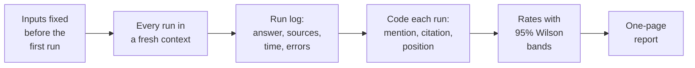

# Repeated Sampling of Visibility and Position (RSVP)

**An open framework for measuring how visible a brand is in AI answers.**

## About RSVP

RSVP takes a brand, a competitor set and a list of buyer questions, runs every question many times on each AI engine, and reports visibility as a range with a 95% confidence band instead of a single number. It answers the question a client asks: when buyers ask an AI assistant about our category, do we come up, where in the answer, and how sure are we?



*Figure: how one RSVP measurement runs, from fixed inputs to the report.*

## The Seven Measures

1. [Mention](https://github.com/tanmaypatange/rsvp/wiki/Measure-1-Mention). The brand name appears in the answer text.
2. [Citation](https://github.com/tanmaypatange/rsvp/wiki/Measure-2-Citation). The brand's domain is among the cited sources.
3. [Position](https://github.com/tanmaypatange/rsvp/wiki/Measure-3-Position). Where the brand sits among the brands named.
4. [Visibility Rate](https://github.com/tanmaypatange/rsvp/wiki/Measure-4-Visibility-rate). The share of runs with a mention or a citation.
5. [Confidence Bands](https://github.com/tanmaypatange/rsvp/wiki/Measure-5-Confidence-bands). How sure the rate is.
6. [Share of Voice](https://github.com/tanmaypatange/rsvp/wiki/Measure-6-Share-of-voice). The client's share of mentions against named competitors.
7. [Run Spread](https://github.com/tanmaypatange/rsvp/wiki/Measure-7-Run-spread). How much the answer changes between runs.

Read the [Overview](https://github.com/tanmaypatange/rsvp/wiki/Framework-overview) for all seven on one page.

**Tidewater Ledger example.** The kit's sample report measures a made-up brand, Tidewater Ledger, on three made-up engines. Its visibility rate is 71% on Engine C (63 of 89 valid runs, band 61 to 79), 28% on Engine A (25 of 89, band 20 to 38) and 27% on Engine B (24 of 88, band 19 to 37). The bands show Engine C above the other two and no difference between A and B. The same example runs through every page of this doc.

## What the Research Shows

- **0.33 to 0.48.** The overlap between the brands named in two runs of the same prompt within 24 hours, where 1.0 means identical ([Schulte et al., 2026](https://arxiv.org/abs/2604.07585), four engines, mean per vertical across three verticals).
- **57.8%.** The share of ChatGPT repetitions that did not activate web search in that study's setup ([Schulte et al., 2026](https://arxiv.org/abs/2604.07585)).
- **67.0%.** Adjacent-day source turnover on a benchmark of 15 commercial prompts ([Tannenbaum, 2026](https://arxiv.org/abs/2609.22655)).

These figures describe their studies, not any one brand. See [Why do AI answers vary?](https://github.com/tanmaypatange/rsvp/wiki/Why-do-AI-answers-vary).

## Why RSVP?

A single check records one draw from a noisy process. If the brand appears, the check cannot say whether it appears most of the time or once in a while. RSVP treats each answer as one sample, so the result shows both the typical outcome and how much it moves.

## RSVP vs a Single Check

| **Aspect** | **Single check** | **RSVP** |
|---|---|---|
| Sample | One answer | Many runs per prompt, engine and declared location |
| Result | Appears or does not | A rate with a 95% band |
| Engines | Usually one | Reported separately, never pooled |
| Competitors | Chosen as you go | A set of two to four, fixed before the first run |
| Stability | Hidden | Reported as run spread |

## Start Here

- [What is RSVP?](https://github.com/tanmaypatange/rsvp/wiki/What-is-RSVP) for the definition.
- [Quickstart](https://github.com/tanmaypatange/rsvp/wiki/Quickstart) to run a first measurement.
- [Install and run the kit](https://github.com/tanmaypatange/rsvp/wiki/Install-and-run-the-kit) to set up the kit and try the dry run.
- [The RSVP kit](#the-rsvp-kit) on the repository front page, with the code, the config and the tests.
- [Sample report](https://github.com/tanmaypatange/rsvp/wiki/Sample-report) for the one-page report format.
- [Limitations](https://github.com/tanmaypatange/rsvp/wiki/Limitations) for what RSVP cannot tell you yet.

## All Pages

### Guide

- [What is RSVP?](https://github.com/tanmaypatange/rsvp/wiki/What-is-RSVP)
- [RSVP vs single checks and share of voice](https://github.com/tanmaypatange/rsvp/wiki/RSVP-vs-single-checks)
- [Why do AI answers vary?](https://github.com/tanmaypatange/rsvp/wiki/Why-do-AI-answers-vary)
- [How does RSVP work?](https://github.com/tanmaypatange/rsvp/wiki/How-RSVP-works)
- [How to Run Your First RSVP Measurement: The Quickstart](https://github.com/tanmaypatange/rsvp/wiki/Quickstart)
- [Install and run the kit](https://github.com/tanmaypatange/rsvp/wiki/Install-and-run-the-kit)
- [What does an RSVP measurement need as input?](https://github.com/tanmaypatange/rsvp/wiki/Inputs)
- [Prompt list and intent](https://github.com/tanmaypatange/rsvp/wiki/Prompt-list-and-intent)
- [Engines and location](https://github.com/tanmaypatange/rsvp/wiki/Engines-and-location)
- [Runs and sample size](https://github.com/tanmaypatange/rsvp/wiki/Runs-and-sample-size)
- [Reading results](https://github.com/tanmaypatange/rsvp/wiki/Reading-results)
- [What are the limitations of RSVP?](https://github.com/tanmaypatange/rsvp/wiki/Limitations)
- [RSVP FAQ](https://github.com/tanmaypatange/rsvp/wiki/FAQ)

### Framework: the seven measures

- [Overview](https://github.com/tanmaypatange/rsvp/wiki/Framework-overview)
- [1. Mention](https://github.com/tanmaypatange/rsvp/wiki/Measure-1-Mention)
- [2. Citation](https://github.com/tanmaypatange/rsvp/wiki/Measure-2-Citation)
- [3. Position](https://github.com/tanmaypatange/rsvp/wiki/Measure-3-Position)
- [4. Visibility Rate](https://github.com/tanmaypatange/rsvp/wiki/Measure-4-Visibility-rate)
- [5. Confidence Bands](https://github.com/tanmaypatange/rsvp/wiki/Measure-5-Confidence-bands)
- [6. Share of Voice](https://github.com/tanmaypatange/rsvp/wiki/Measure-6-Share-of-voice)
- [7. Run Spread](https://github.com/tanmaypatange/rsvp/wiki/Measure-7-Run-spread)

### Reference

- [RSVP Reporting Rules v0.1: Draft Specification](https://github.com/tanmaypatange/rsvp/wiki/Reporting-rules-v01)
- [RSVP report: Tidewater Ledger](https://github.com/tanmaypatange/rsvp/wiki/Sample-report)

### About

- [Credits and References](https://github.com/tanmaypatange/rsvp/wiki/Credits-and-references)
- [Docs changelog](https://github.com/tanmaypatange/rsvp/wiki/Docs-changelog)

# The RSVP kit

This repository also holds a runnable kit for RSVP: one config file, one command, one report. It uses only the Python standard library. The sample report in [sample/sample_report.md](sample/sample_report.md) is made by its dry run, and every number in it is fictional.

## Install

You need Python 3.8 or later (tested on 3.13). There is nothing else to install: the kit uses only the standard library, including its HTTP client.

```bash
git clone https://github.com/tanmaypatange/rsvp.git rsvp && cd rsvp
```

## Try it first: the dry run

```bash
python3 rsvp.py dry-run
```

This runs the real runner, counter, reporter and run log on bundled fictional data, with a fake engine that returns canned answers. No engine is called and no key is needed. It writes `measurements-dry-run/sample-tidewater-m1/report.md`, which matches `sample/sample_report.md`.

## Run a measurement

1. Copy the config and the prompt list, then fill both in.

   ```bash
   cp config.example.yaml config.yaml
   ```

   ```bash
   cp prompts.template prompts.yaml
   ```

2. Put your engine keys in `keys.env`, one `NAME=value` per line, with the names used in `key_env`. The file is gitignored. Keys are never written to the run log or the report.

3. Check the config.

   ```bash
   python3 rsvp.py validate --config config.yaml
   ```

4. Run. Each call runs the next scheduled day. Run the same command once a day until the plan is done; the report is written after the last run.

   ```bash
   python3 rsvp.py run --config config.yaml
   ```

## What is in the kit

1. **`config.example.yaml`**: the brand, domain, aliases, exclusions, two to four competitors, the prompt list, the engines, the declared location, runs per prompt and the pilot threshold.
2. **`prompts.template`**: a blank prompt list, one intent label and one need ID per prompt.
3. **Runner** (`runner.py`, adapters in `engines/`): sends every location x engine x prompt x run in a fresh context, with no follow-ups, and stores the answer, sources, time and any error.
4. **Counter** (`counter.py`): codes each run for mention, citation, ghost citation and position.
5. **Reporter** (`reporter.py`, `report_template.md`): computes the rates, bands, share of voice and run spread, and writes the one-page report. It refuses to write a report with an empty slot.
6. **Run log** (`runlog.py`): one row per run, append only. The config is hashed when a measurement starts.
7. **Sample report** (`sample/sample_report.md`): built by the dry run from made-up canned answers, labelled illustrative. The raw run log (`sample/sample_runlog.jsonl`) and the coded run log (`sample/sample_coded_runlog.csv`) it is built from sit beside it. `sample/README.md` explains each file and how they connect.

Plus `rsvp.py` (the command line), `bands.py` (the Wilson band and other statistics), `config.py`, `yamlsubset.py` (a small YAML reader), and `tests/`.

## Config

The config is the pre-registered protocol. Every key is commented in `config.example.yaml`. Key points:

- **Brand and aliases.** Close the alias list before the first run. Changing the aliases, or anything else in the protocol, starts a new measurement ID; runs of two measurement IDs are never mixed.
- **Competitors.** Two to four, fixed before the first run. Other brands are logged and listed, never counted in share of voice.
- **Prompts.** One label per prompt: `informational`, `commercial` or `transactional`. Paraphrases of one need share a need ID. The headline list is unbranded. Prompts that name the client go in a labelled branded block (`branded: true`).
- **Engines.** Adapters: `openai_responses`, `perplexity` and `fake`; see CONTRIBUTING.md to add one. Treat two modes of one product as two engines. `location_method` is `setting` (the engine's location setting) or `prompt` (a sentence at the start of the prompt).
- **Runs.** `runs_per_prompt` is the sample size, spread across `schedule_days`. There is no minimum: choose it from the band width your decision needs. Start with a pilot.
- **Working ranges.** `validate` prints a notice, not an error, when the config has fewer than three or more than six engines, or fewer than four or more than eight unbranded prompts in an intent. The kit still runs outside them.
- **Reporting.** `pilot_threshold`, `first_measurement`, `directional_band_width` and `remeasure_weeks` set the pilot label, the directional wording and the next measurement date.

## Outputs

Each measurement gets a folder under `measurements/<measurement_id>/`:

| File | What it holds |
|---|---|
| `manifest.json` | Measurement ID, config hash, code and method version, planned runs |
| `protocol.json` | The protocol as hashed at the start |
| `plan.json` | Every planned run with its day and order |
| `runlog.jsonl` | One row per run, append only: prompt sent, answer, sources (raw and resolved), status, error, times |
| `changes.jsonl` | Corrections to the coding; the original rows are kept |
| `deviations.jsonl` | Deviations found while running, for example an engine stopped |
| `coded_runlog.csv` | The counter's coding of every run, rebuilt with each report |
| `report.md` | The one-page report and its method note |

`measurements/index.jsonl` lists every measurement ID with its config hash.

## Quality checks

A second analyst recodes a random 10% of valid runs blind, and the report shows the agreement:

```bash
python3 rsvp.py recode-sample --measurement measurements/<id>
```

```bash
python3 rsvp.py agreement --measurement measurements/<id> --file measurements/<id>/recode_sample.csv
```

Use `--n 10` on `recode-sample` for the dry-run check of about ten answers before the first real run. To correct a coding error, add a row to the change list and rebuild the report:

```bash
python3 rsvp.py correct --measurement measurements/<id> --run R00042 --field mention --new 1 --reason "alias split by a line break"
```

```bash
python3 rsvp.py report --measurement measurements/<id>
```

## Test

```bash
python3 -m unittest discover -s tests -t .
```

The tests cover every counting and reporting rule the kit implements, the refusal conditions, and an end-to-end dry run that must reproduce `sample/sample_report.md` exactly. The Wilson test reproduces 4 of 10 as 17 to 69, 12 of 30 as 25 to 58, 0 of 30 as 0 to 11, 30 of 30 as 89 to 100 and 103 of 349 as 25 to 35.

## RSVP decisions the kit applies

These choices are RSVP decisions, not published findings:

- 95% Wilson bands for every rate; none for share of voice in v0.1, because mentions within one run are not independent trials.
- Three exclusive position bands: first named, second or third, fourth or later.
- A fixed, pre-named competitor set of two to four.
- Re-measure every four weeks by default.
- A report is labelled a pilot when runs per prompt are at or below `pilot_threshold` (10 by default) or when the config says it is a first measurement. The headline is marked directional when any headline band is wider than `directional_band_width` (20 points by default) or when the sample is a pilot.
- A competitor rotates in a cell if it appears in more than 10% and fewer than 90% of the cell's valid runs.
- An explicit refusal in text is a valid run; an empty body is a failed run.

The cell classes (never, rarely under 30%, flipping 30% to 70%, mostly, always) follow [Kumar (2026)](https://arxiv.org/abs/2606.20065). Every study the docs name is listed in [credits and references](https://github.com/tanmaypatange/rsvp/wiki/Credits-and-references).

## What the kit does not do

No composite score, no sentiment, no traffic or revenue figures, no exact-URL claims, no prompt rankings from small counts, no bands on share of voice. It measures; it does not explain why a brand is or is not named.
