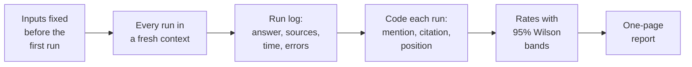

# Repeated Sampling of Visibility and Position (RSVP)

**An open framework for measuring how visible a brand is in AI answers.**

## About RSVP

RSVP takes a brand, a competitor set and a list of buyer questions, runs every question many times on each AI engine, and reports visibility as a range with a 95% confidence band instead of a single number. It answers the question a client asks: when buyers ask an AI assistant about our category, do we come up, where in the answer, and how sure are we?

*Figure: how one RSVP measurement runs, from fixed inputs to the report.*

## The Seven Measures

1. [Mention](framework/1-mention.md). The brand name appears in the answer text.
2. [Citation](framework/2-citation.md). The brand's domain is among the cited sources.
3. [Position](framework/3-position.md). Where the brand sits among the brands named.
4. [Visibility Rate](framework/4-visibility-rate.md). The share of runs with a mention or a citation.
5. [Confidence Bands](framework/5-confidence-bands.md). How sure the rate is.
6. [Share of Voice](framework/6-share-of-voice.md). The client's share of mentions against named competitors.
7. [Run Spread](framework/7-run-spread.md). How much the answer changes between runs.

Read the [Overview](framework/overview.md) for all seven on one page.

**Tidewater Ledger example.** The kit's sample report measures a made-up brand, Tidewater Ledger, on three made-up engines. Its visibility rate is 71% on Engine C (63 of 89 valid runs, band 61 to 79), 28% on Engine A (25 of 89, band 20 to 38) and 27% on Engine B (24 of 88, band 19 to 37). The bands show Engine C above the other two and no difference between A and B. The same example runs through every page of this doc.

## What the Research Shows

- **0.33 to 0.48.** The overlap between the brands named in two runs of the same prompt within 24 hours, where 1.0 means identical ([Schulte et al., 2026](https://arxiv.org/abs/2604.07585), four engines, mean per vertical across three verticals).
- **57.8%.** The share of ChatGPT repetitions that did not activate web search in that study's setup ([Schulte et al., 2026](https://arxiv.org/abs/2604.07585)).
- **67.0%.** Adjacent-day source turnover on a benchmark of 15 commercial prompts ([Tannenbaum, 2026](https://arxiv.org/abs/2609.22655)).

These figures describe their studies, not any one brand. See [Why do AI answers vary?](guide/why-ai-answers-vary.md).

## Why RSVP?

A single check records one draw from a noisy process. If the brand appears, the check cannot say whether it appears most of the time or once in a while. RSVP treats each answer as one sample, so the result shows both the typical outcome and how much it moves.

## RSVP vs a Single Check

| **Aspect** | **Single check** | **RSVP** |
|---|---|---|
| Sample | One answer | Many runs per prompt, engine and declared location |
| Result | Appears or does not | A rate with a 95% band |
| Engines | Usually one | Reported separately, never pooled |
| Competitors | Chosen as you go | A set of two to four, fixed before the first run |
| Stability | Hidden | Reported as run spread |

## Start Here

- [What is RSVP?](guide/what-is-rsvp.md) for the definition.
- [Quickstart](guide/quickstart.md) to run a first measurement.
- [Install and run the kit](guide/install-and-run-the-kit.md) to set up the kit and try the dry run.
- [The RSVP kit](../README.md#the-rsvp-kit) on the repository front page, with the code, the config and the tests.
- [Sample report](reports/sample-report.md) for the one-page report format.
- [Limitations](guide/limitations.md) for what RSVP cannot tell you yet.

## All Pages

### Guide

- [What is RSVP?](guide/what-is-rsvp.md)
- [RSVP vs single checks and share of voice](guide/rsvp-vs-single-checks.md)
- [Why do AI answers vary?](guide/why-ai-answers-vary.md)
- [How does RSVP work?](guide/how-rsvp-works.md)
- [How to Run Your First RSVP Measurement: The Quickstart](guide/quickstart.md)
- [Install and run the kit](guide/install-and-run-the-kit.md)
- [What does an RSVP measurement need as input?](guide/inputs.md)
- [Prompt list and intent](guide/prompt-list-and-intent.md)
- [Engines and location](guide/engines-and-location.md)
- [Runs and sample size](guide/runs-and-sample-size.md)
- [Reading results](guide/reading-results.md)
- [What are the limitations of RSVP?](guide/limitations.md)
- [RSVP FAQ](guide/faq.md)

### Framework: the seven measures

- [Overview](framework/overview.md)
- [1. Mention](framework/1-mention.md)
- [2. Citation](framework/2-citation.md)
- [3. Position](framework/3-position.md)
- [4. Visibility Rate](framework/4-visibility-rate.md)
- [5. Confidence Bands](framework/5-confidence-bands.md)
- [6. Share of Voice](framework/6-share-of-voice.md)
- [7. Run Spread](framework/7-run-spread.md)

### Reference

- [RSVP Reporting Rules v0.1: Draft Specification](specifications/reporting-rules-v01.md)
- [RSVP report: Tidewater Ledger](reports/sample-report.md)

### About

- [Credits and References](about/credits-and-references.md)
- [Docs changelog](CHANGELOG.md)

Last updated: November 26, 2026
