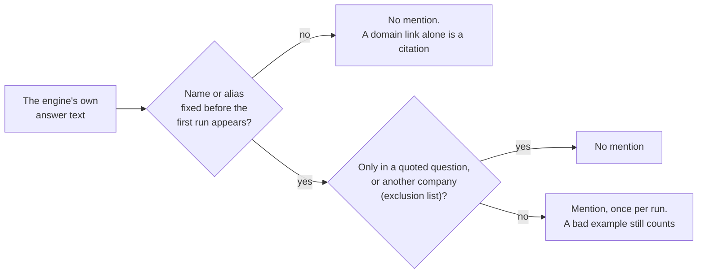

# 1. Mention

**A mention is the brand name, or an alias from a list fixed before the first run, appearing in the answer text.**

A run counts once however often the name appears. A domain link without the name is a citation, not a mention. The mention rate is runs with a mention divided by valid runs.

## What It Is

Mention records whether the engine names the brand in its own answer. It is the plainest of the RSVP measures: the name is there or it is not. Competitors are counted by the same rule, which is what lets [Share of voice](6-share-of-voice.md) be computed.

## Why It Matters

Name matching on a fixed lexicon misses synonyms and abbreviations and can give false positives. [Schulte et al. (2026](https://arxiv.org/abs/2604.07585)) used substring matching and name this as a limit of their detection. In their real estate vertical, brand detection reached only 53.6%, under their 70% threshold, so that vertical was excluded from the brand analysis. Written rules and a sample check make such errors visible.

## Mention Records Presence, Not Tone

RSVP version 0.1 does not measure sentiment. [Kumar (2026](https://arxiv.org/abs/2606.20065)) reports that sentiment is noisier than mention, with a flip rate of 45.5% in that cohort, mixing real variation and classifier noise.

A mention also does not say the brand was recommended, ranked first or used as evidence. [Position](3-position.md) and [Citation](2-citation.md) answer those separately. [Martinez (2026b](https://arxiv.org/abs/2609.06811)) makes the general point that retrieval, citation and brand mention must be measured separately, and that mentions need their own detection rule.

## How to Measure

### 1. Write the Alias List Before the First Run

List the official name, product names, common short forms and spelling variants. Close the list before the first run. Adding an alias later changes what counts as a mention, so it starts a new measurement.

### 2. Count a Run Once

If the name appears three times in one answer, the run still counts as one mention. Count the run, not the occurrences.

### 3. Apply the Same Rule to Every Case

| **Case** | **Counts as a mention?** |
|---|---|
| Full or short name in the answer text | Yes |
| Product name on the alias list | Yes |
| A different company with the same word in its name | No. Add it to the exclusion list |
| The brand's domain cited, with no name in the text | No. It is a citation |
| "The company" or a pronoun with no name in the answer | No. Only a name or alias counts |
| The brand named only inside a quoted question | No. It is not the engine's own answer |
| The brand named as a bad example | Yes. A mention records presence, not praise |

*Figure: does a run count as a mention?*

### 4. Check the Matcher by Hand

Before the first run, have two analysts code about ten dry-run answers by hand and compare them with the matcher. Give every disagreement a rule. After the measurement, have a second analyst recode a random 10% of runs, and put the agreement rate in the report. If agreement is below 90%, rewrite the rules and recode the log. This is an RSVP decision.

### 5. Count Competitors the Same Way

Use the same alias-list method for every named competitor, so the rates and the share of voice rest on one rule.

## Examples

❌ Vague:

The brand showed up fairly often.

✅ Verifiable (Tidewater Ledger sample, made-up figures):

Engine A named the brand in 20 of 89 valid runs on the unbranded prompts. The mention rate is 22%, with a 95% band of 15 to 32.

## Checklist

- The alias list was closed before the first run
- Each run counts once, however often the name appears
- A domain link without the name is logged as a citation, not a mention
- The exclusion list covers other companies with the same word
- Two analysts coded dry-run answers, and a second analyst recoded 10% afterwards
- The agreement rate is in the report
- Competitors are counted by the same rule

Previous: [Overview](overview.md) | Next: [2. Citation](2-citation.md)

Last updated: November 26, 2026
