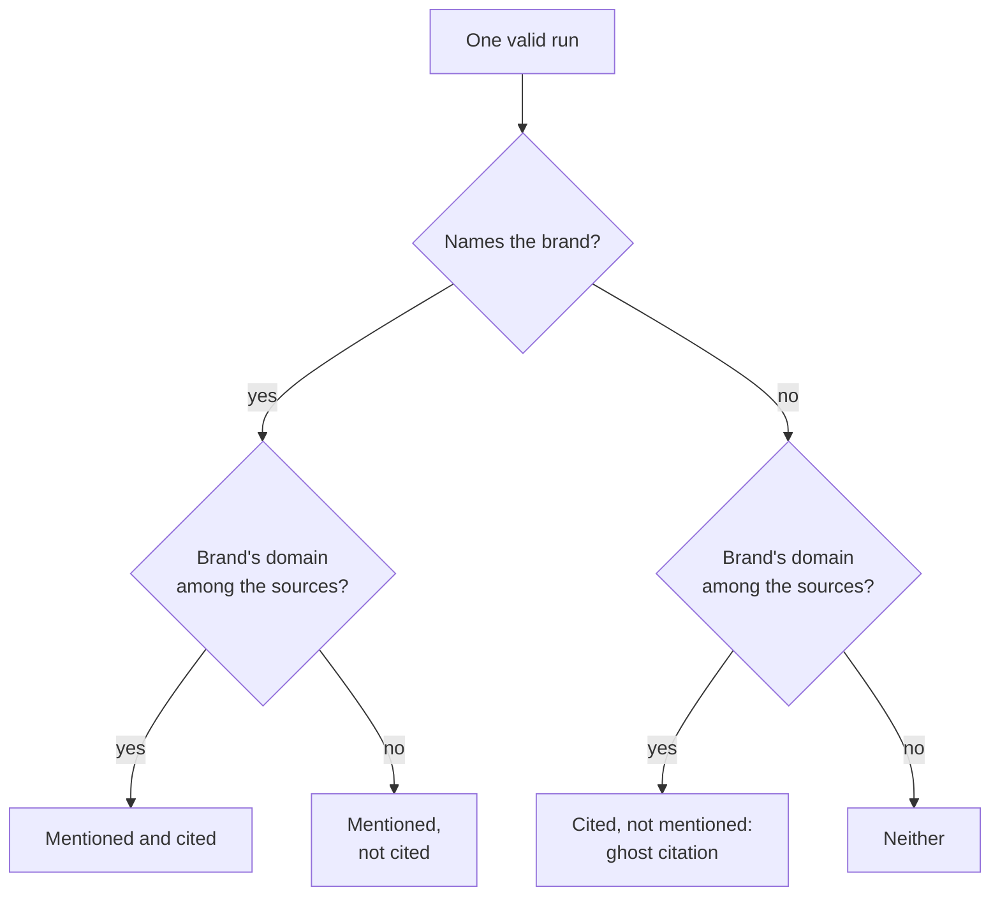

# 2. Citation

**A citation is the brand's domain appearing among the sources an engine shows with an answer.**

RSVP matches at domain level, because API runs only partly reproduce what an engine's web page cites at exact-URL level. A cited domain with no brand name in the text is a ghost citation and is logged separately.

## What It Is

Citation records whether the engine points to the brand's own site as a source. It can happen with or without a [Mention](1-mention.md), and the two are counted separately.

## Why It Matters

[Jiang et al. (2026](https://arxiv.org/abs/2610.15382)) compared ChatGPT Web citations with what Google Search and the OpenAI Responses API return for the same questions. The alternatives only partly reproduced ChatGPT Web, and did better at hostname and entity level than at exact URL. A claim about one particular page is therefore outside the method, and a claim about the domain is inside it.

## Zero-Citation Runs Stay in the Denominator

An answer with no sources shown is a valid run with citation set to zero. In the setup of [Schulte et al. (2026](https://arxiv.org/abs/2604.07585)), 57.8% of ChatGPT repetitions did not activate web search, so zero-citation answers can be most of an engine's runs. Dropping them would inflate every citation rate.

## How to Measure

### 1. Match the Registrable Domain

A run counts as a citation if the client's registrable domain appears in the cited sources the engine returns. Subdomains count. A copy of the brand's page on another domain does not. Two pages of the same domain are one citation.

### 2. Clean the URLs Before Matching

Strip tracking parameters and resolve redirects, and keep the raw URLs in the run log. [Martinez (2026a](https://arxiv.org/abs/2607.14035)) notes that parameters, redirects, AMP versions, translations and aggregators can split a domain artificially, and recommends publishing the resolution rules.

### 3. Sort Every Run Into One of Four Cases

- Mentioned and cited: the answer names the brand and cites its domain.
- Mentioned, not cited: the answer names the brand, but its sources are other sites.
- Cited, not mentioned: the brand's domain is a source, but the text does not name it. This is a ghost citation.
- Neither: the brand is absent.

*Figure: the four cases every valid run falls into.*

### 4. Log Ghost Citations

A ghost citation counts toward the citation rate and the [Visibility rate](4-visibility-rate.md), and not toward the mention rate. A rising ghost count is worth a look: the engine uses the brand's pages without crediting the brand by name.

### 5. Record Other Cited Domains

When the brand is not cited, the sources that are cited show who the engine relies on instead. Record the cited domains of competitors and third parties for that reason.

## Examples

❌ Vague:

Our site is often cited.

✅ Verifiable (Tidewater Ledger sample, made-up figures):

Engine C cited the brand's domain in 36 of 89 valid runs. The citation rate is 40%, with a 95% band of 31 to 51. In 11 of those runs the text did not name the brand.

## What a Citation Does Not Show

A citation does not show that the cited page supports the claim in the answer. A user study of answer engines found that citations were often misattributed ([Narayanan Venkit et al., 2024](https://arxiv.org/abs/2410.22349)), and a security study found that citing a page does not mean its claims enter the answer text ([Liu et al., 2026](https://arxiv.org/abs/2610.11932)). Read the rate as presence among the sources, not as endorsement.

## Checklist

- Matching is at registrable domain level, subdomains included
- Tracking parameters are stripped and redirects resolved, with raw URLs kept
- Every run is sorted into one of the four cases
- Zero-citation runs stay in the denominator
- Ghost citations are logged and counted in the citation and visibility rates only
- Cited domains of competitors and third parties are recorded
- No claim is made about a particular page

Previous: [1. Mention](1-mention.md) | Next: [3. Position](3-position.md)

Last updated: November 26, 2026
