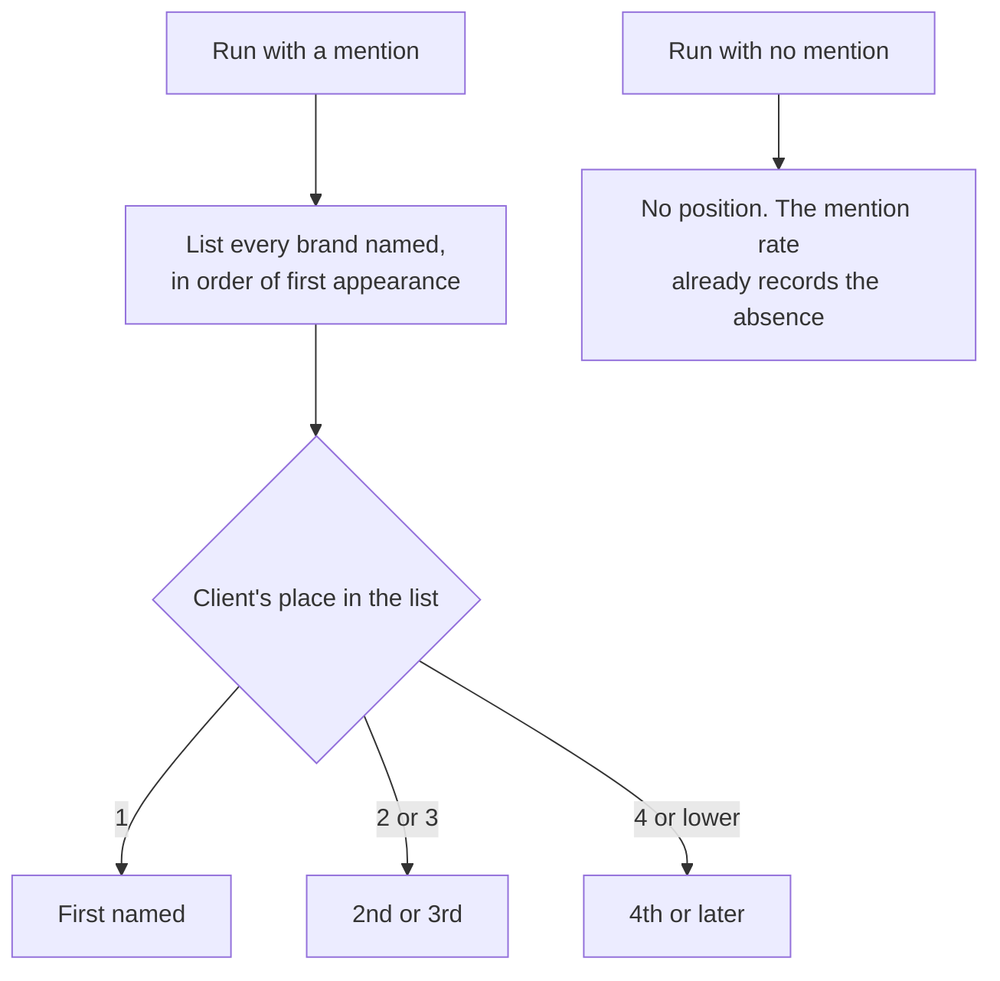

# 3. Position

**Position is where the brand sits in the ordered list of brands the answer names, counted only for runs with a mention.**

RSVP uses three exclusive bands: first named, second or third, and fourth or later. The counts in the three bands add up to the number of mentions.

## What It Is

Position separates a brand that leads the answer from one that is listed late. It depends on [Mention](1-mention.md): a run with no mention has no position, because the mention rate already records the absence.

## Why It Matters

Position is ordinal. [Kumar (2026](https://arxiv.org/abs/2606.20065)) records the brand's position as an ordinal rank in the answer.

The survey by [Martinez (2026a](https://arxiv.org/abs/2607.14035)) lists the rank of first citation and prominence among the levels of visibility, and notes that prominence assumes earlier mentions attract more attention, which has not been tested with human attention data. [Aggarwal et al. (2024](https://arxiv.org/abs/2311.09735)) also treat an earlier position in the answer as more visible. RSVP uses order in the text as a plain, observable proxy and does not claim it measures attention.

## How to Measure

### 1. List Every Brand in Order of First Appearance

Include the client, the named competitors and any other brand the answer names. The client's position is its place in that list.

### 2. Assign One of Three Exclusive Bands

| **Band** | **Meaning** |
|---|---|
| First named | The client is brand number 1 |
| 2nd or 3rd | The client is brand number 2 or 3 |
| 4th or later | The client is brand number 4 or lower |

The bands do not overlap. A brand that is first named is not also counted as in the top three.

*Figure: how a mention is placed in one of three bands.*

### 3. Apply the Edge-Case Rules

- A numbered list: use the order of the list, even if the engine adds a bold lead-in.
- A table: read rows top to bottom, and left to right within a row.
- A brand named twice: use its first appearance.
- A brand named only in a closing line: that line gives its position.
- Sponsored blocks marked by the engine: code them as their own source type and leave them out of the order. Unmarked blocks count as ordinary text. The kit does this for blocks an adapter passes as sponsored. The bundled openai_responses and perplexity adapters pass none, so a sponsored block inside their answer text counts as ordinary text.

### 4. Report Counts, Not an Average

Write "first named in 16 of 52 mentions". Do not write "typical position 1", because an average of ordinal ranks hides the bands.

## Examples

❌ Hidden:

Typical position: 1.4.

✅ Visible (Tidewater Ledger sample, made-up figures):

Engine C named the brand in 52 runs. The brand was first named in 16, second or third in 29 and fourth or later in 7.

## Read Position Next to the Mention Rate

A brand can be named often and always late, or rarely and always first. The two do not always move together, so read position beside the mention rate and the [Visibility rate](4-visibility-rate.md), never alone.

## Checklist

- Position is counted only for runs with a mention
- Every named brand is listed in order of first appearance
- Each mention falls in exactly one of the three bands
- The edge-case rules were applied the same way in every run
- The report gives band counts out of mentions, not an average rank
- Position is shown next to the mention rate

Previous: [2. Citation](2-citation.md) | Next: [4. Visibility Rate](4-visibility-rate.md)

Last updated: November 26, 2026
