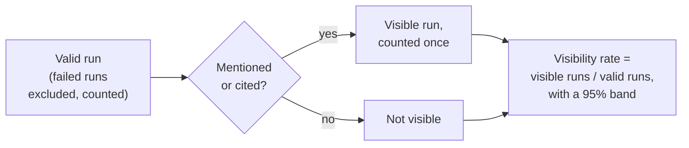
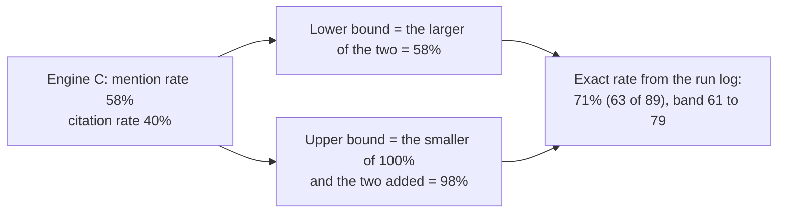

# 4. Visibility Rate

**The visibility rate is the share of valid runs in which the brand is mentioned or its domain is cited.**

It is computed from the run log and shown per engine and declared location, with a [confidence band](5-confidence-bands.md). If a table shows only a mention rate and a citation rate, the visibility rate lies between the larger of the two and the smaller of 100% and their sum.

## What It Is

The visibility rate is the headline result of an RSVP measurement. The definition is wide on purpose: a brand the engine names counts, and a brand whose pages the engine shows counts even without a name.

## Why It Matters

The rate has one denominator and one rule. RSVP does not combine mention, citation, position and tone into one number, because two brands with the same composite can have opposite problems. [Martinez (2026b](https://arxiv.org/abs/2609.06811)) says a visibility score needs a declared detection rule and denominator, and the visibility rate states both.

## Visibility Means Different Things in Other Tools

The word is used for many different quantities. [Martinez (2026a](https://arxiv.org/abs/2607.14035)) counts at least nine and warns that each has its own denominator, and that a citation does not establish a positive visibility or an economic outcome. [Kumar (2026](https://arxiv.org/abs/2606.20065)) treats visibility as the mention rate alone. A reader comparing RSVP with a tool that counts mentions only should compare the [Mention](1-mention.md) rate.

## How to Measure

### 1. Count the Visible Runs

A run is visible if the brand is mentioned or its domain is cited. Count each such run once.

### 2. Divide by Valid Runs

The visibility rate is visible runs divided by valid runs. Failed runs are excluded and counted.

*Figure: the visibility rate.*

### 3. When Only Two Rates Are Shown, State the Bounds

Many tables show a mention rate and a citation rate and no visibility column. The exact visibility rate then needs the run log. Without it, the rate must lie between two bounds.

- Lower bound: the larger of the mention rate and the citation rate, because visible runs include every mention run and every citation run.
- Upper bound: the smaller of 100% and the two rates added, reached only if no run had both events.

*Figure: bounds on the visibility rate when only two rates are shown (Tidewater Ledger sample, Engine C, made-up figures).*

### 4. Report It With Its Context

State the engine, the declared location, the prompt list, the number of valid runs and the confidence band.

## Examples

❌ Vague:

Visibility is around half.

✅ Verifiable (Tidewater Ledger sample, made-up figures):

Engine C had a mention rate of 58% and a citation rate of 40%. The bounds are 58% and 98%. The exact visibility rate from the log was 71% (63 of 89), with a band of 61 to 79.

## Checklist

- A run is visible if the brand is mentioned or cited
- The denominator is valid runs, with failed runs excluded and counted
- The rate is shown per engine and declared location, never pooled
- Each rate has a 95% band
- Bounds are stated when only the mention and citation rates are shown
- The engine, location, prompt list and run count are stated beside the rate

Previous: [3. Position](3-position.md) | Next: [5. Confidence Bands](5-confidence-bands.md)

Last updated: November 26, 2026
