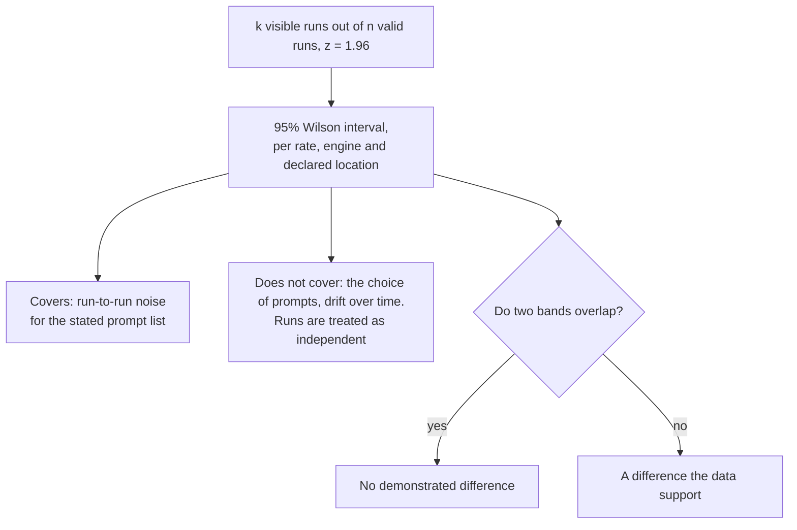

# 5. Confidence Bands

**RSVP bands are 95% Wilson intervals for a proportion, computed for each rate, engine and declared location.**

A band covers run-to-run noise for the stated prompt list. It does not cover the choice of prompts or drift over time, and it assumes runs are independent.

## What It Is

A confidence band is the range around a rate that shows how sure the measurement is. It lets a reader see whether a rate of 40% from 10 runs is the same kind of fact as 40% from 30 runs. It is the reason [Visibility rate](4-visibility-rate.md) is reported as a range.

## Why It Matters

If the same prompt list were run again on the same engine and location with the same number of runs, the band is the range where the new rate would usually fall.

The visibility studies that report intervals use 95% levels. [Chen and Koudas (2026](https://arxiv.org/abs/2610.24081)) give bootstrap intervals for a localisation index, [Tannenbaum (2026](https://arxiv.org/abs/2609.22655)) gives prompt-clustered bootstrap intervals, and [Kumar (2026](https://arxiv.org/abs/2606.20065)) uses bootstrap intervals with 10,000 resamples. They resample because their quantities are indices. For a simple proportion of runs a closed form is enough and easy to check.

## What the Band Does Not Cover

- Run dependence. The calculation treats every run as an independent trial. Runs of different prompts share a brand and a market, so the pooled band is a little too narrow. [Martinez (2026a](https://arxiv.org/abs/2607.14035)) warns that treating all generations as independent understates uncertainty and recommends a cluster bootstrap. RSVP v0.1 states this limit in every report.
- The prompt list. The band describes the stated list. [Tannenbaum (2026](https://arxiv.org/abs/2609.22655)) says the same of its intervals: they describe the benchmark only.
- Drift. A band from five days of runs says nothing about next month.

## How to Measure

### 1. Compute the Wilson Interval

For k visible runs out of n valid runs, let p = k / n and z = 1.96. The Wilson interval is the centre plus or minus a half-width:

- centre = (p + z^2 / 2n) / (1 + z^2 / n)
- half-width = z * sqrt(p(1 - p) / n + z^2 / 4n^2) / (1 + z^2 / n)

The interval stays between 0 and 100% and behaves sensibly when the rate is near 0% or 100%, which is common here. The simple "p plus or minus 1.96 standard errors" band does neither. The choice of the Wilson form is an RSVP decision.

### 2. Show Bands at Engine and Intent Level

A band widens as the cell shrinks. In the Tidewater Ledger sample, Engine A's visibility rate across all 89 valid unbranded runs has a band 18 points wide (20 to 38). For one engine and one intent (29 or 30 runs) the mention-rate bands are 16 to 33 points wide, and for one engine on one day (17 or 18 runs) they are 30 to 40 points wide. One engine and one prompt has only 10 runs, so the band is wider still: 4 of 10 is 17 to 69. Show bands at engine and intent level, show prompt-level counts without bands, and do not rank prompts from those counts.

*Figure: what the band covers and how two bands are compared.*

### 3. Compare Two Rates by Their Bands

Two rates differ in a way the data support when their bands do not overlap. Overlapping bands mean no demonstrated difference, though a difference may exist. This rule is deliberately cautious. A move over time that stays inside the old band is not a change, if the prompt list, alias list and run counts stayed the same.

### 4. Write Zero Counts Carefully

A zero count is not "never". Write "not observed in 30 runs" and give the band.

## Examples

| **Successes** | **Runs** | **Rate** | **95% Wilson band** |
|---|---|---|---|
| 4 | 10 | 40.0% | 17 to 69 |
| 12 | 30 | 40.0% | 25 to 58 |
| 0 | 30 | 0.0% | 0 to 11 |
| 30 | 30 | 100.0% | 89 to 100 |

These counts are illustrative. The same 40% is a wide claim at 10 runs and a narrower one at 30, and 0 of 30 still allows a rate up to 11%.

## Checklist

- Every rate has a 95% Wilson band, per engine and declared location
- The report states that runs are treated as independent
- Bands appear at engine and intent level, and prompt-level counts have none
- Two rates are called different only when their bands do not overlap
- A zero count is written as "not observed in n runs"
- The band is described as covering run noise for the stated prompt list only

Previous: [4. Visibility Rate](4-visibility-rate.md) | Next: [6. Share of Voice](6-share-of-voice.md)

Last updated: November 26, 2026
