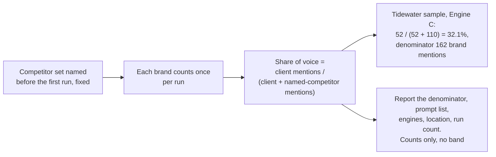

# 6. Share of Voice

**Share of voice is the client's brand mentions divided by the client's plus those of the named competitors, over the same runs.**

The competitor set is fixed before the first run. RSVP has no composite score, and any share of voice is reported with its prompt list, engines, declared location, run count and denominator.

## What It Is

Share of voice answers how much of the talk about the category is the client's. It counts [Mention](1-mention.md) only, and it depends on who is in the competitor set.

## Why It Matters

Composite scores average different things, and a single figure hides which one moved. [Martinez (2026b](https://arxiv.org/abs/2609.06811)) warns that a visibility score without a declared detection rule and denominator cannot be interpreted. A study of engine-agnostic page scores found cross-engine divergence and concluded that such scores have limits ([Tannenbaum, 2026](https://arxiv.org/abs/2609.22655)). RSVP therefore has no composite score.

## Share of Voice Is Not the Visibility Rate

The [Visibility rate](4-visibility-rate.md) counts runs in which the brand shows up and includes citations. Share of voice counts mentions only. A brand named in every answer beside the same three competitors has a visibility rate of 100% and a share of voice near 25%. A mention rate can rise while share of voice falls, if competitors rise faster.

## How to Measure

### 1. Fix the Competitor Set First

Name the competitors before the first run and keep the set fixed. Other brands that engines name are not in the formula. [Kumar (2026](https://arxiv.org/abs/2606.20065)) defines the same quantity with "qualified" competitors that recur or resolve to a real domain. RSVP replaces "qualified" with "named in advance", so the set cannot shift between measurements.

### 2. Count One Mention per Brand per Run

A brand named three times in one answer counts once.

### 3. Apply the Formula

share of voice = client mentions / (client mentions + named-competitor mentions)

*Figure: how share of voice is counted (Tidewater Ledger sample, made-up figures).*

### 4. State the Denominator

Write the denominator as the number of brand mentions counted, and give the prompt list, engines, declared location and run count beside the figure.

### 5. Give Counts, Not a Band

There is no band for share of voice in v0.1. Mentions within one run are not independent trials, so a plain Wilson band would mislead. Give the counts and call the figure descriptive. A prompt-clustered bootstrap is the planned next step.

### 6. Do Not Call Any Figure a Score Without Its Details

A score is any single summary figure computed from runs: a mention rate, a visibility rate, a share of voice or a figure from another tool. A figure called "share of voice" without its prompt list, engines and denominator cannot be interpreted. Ask for those details before accepting such a number, and give them for your own.

## Examples

❌ Unclear:

Our share of voice is 21%.

✅ Verifiable (Tidewater Ledger sample, made-up figures):

With three named competitors, Engine A showed 20 client mentions against 115 competitor mentions, a share of voice of 14.8% (denominator 135 brand mentions). Engine B showed 14 against 118, or 10.6%, and Engine C 52 against 110, or 32.1%.

## Checklist

- The competitor set was named before the first run and has not changed
- Each brand counts once per run
- The denominator is stated as the number of brand mentions counted
- The prompt list, engines, declared location and run count appear beside the figure
- The figure is described as descriptive, with counts and no band
- No composite score is reported

Previous: [5. Confidence Bands](5-confidence-bands.md) | Next: [7. Run Spread](7-run-spread.md)

Last updated: November 26, 2026
