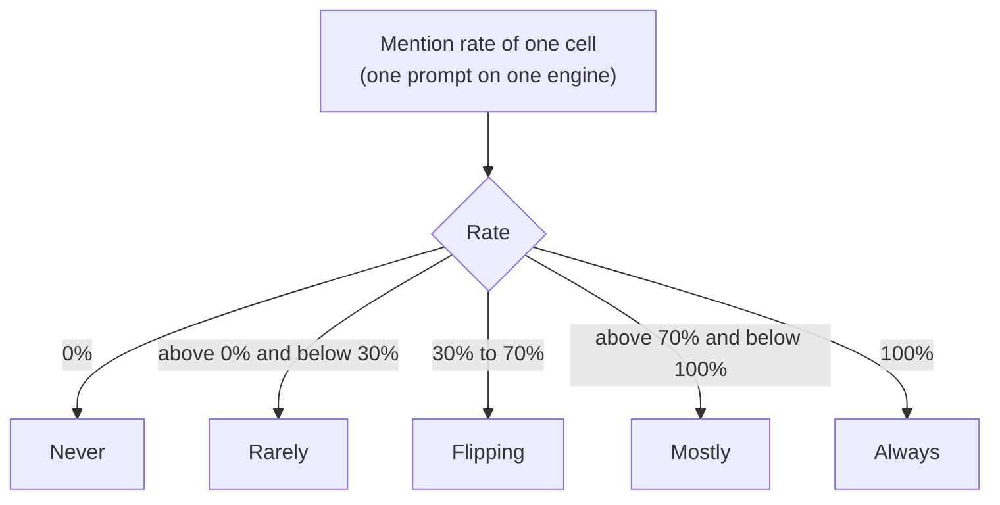

# 7. Run Spread

**Run spread shows how much the answer changes between repeated runs of the same question on the same engine.**

RSVP reports how many prompt cells are never, rarely, flipping, mostly or always mentioned, the overlap of brands and domains between runs, and day-by-day rates. Two brands with the same visibility rate can have very different spread.

## What It Is

A cell is one prompt on one engine. Run spread describes how stable the answer is inside each cell, so a reader sees whether a rate comes from the same answer each time or from a coin toss.

## Why It Matters

If most cells are flipping, one check is close to a coin toss. An engine is repeatable only in a distributional sense, and even a reported temperature of zero fixes neither the index nor retrieval ([Martinez, 2026a](https://arxiv.org/abs/2607.14035)). A report with only rates would hide what RSVP exists to show.

## Spread Tells You Where to Add Runs

A stable list with shifting order means the brand holds its place and the question is rank. Rotating competitors mean the field is open and the brand's place depends on who else appears. Wide swings mean the measurement is moving and needs more runs before anyone acts on it. See [Runs and sample size](../guide/runs-and-sample-size.md).

## How to Measure

### 1. Classify Each Cell by Its Mention Rate

- Never: 0%
- Rarely: above 0% and below 30%
- Flipping: 30% to 70%
- Mostly: above 70% and below 100%
- Always: 100%

The cut points follow [Kumar (2026](https://arxiv.org/abs/2606.20065)).

*Figure: the five cell classes.*

### 2. Compute Set Overlap

For each cell, take every pair of valid runs and compute the Jaccard index of the brands named, then of the domains cited. 1.0 means identical sets. [Schulte et al. (2026](https://arxiv.org/abs/2604.07585)) use this measure within and across days, and [Tannenbaum (2026](https://arxiv.org/abs/2609.22655)) uses it across engines.

### 3. Track Day-by-Day Drift

Compute the mention rate for each day separately. Each day in the Tidewater Ledger sample held 17 or 18 valid runs per engine, so each day's rate had a band of roughly 30 to 40 points. A one-day move is not a finding. A general drift over five days is a reason to re-measure sooner. In the sample, Engine C's mention rate was 67% on the first day and 59% on the last, and the bands overlap, so no change is shown.

### 4. Describe Spread in Words

- "Stable list, order shifts." The same brands appear and their order changes.
- "Two of the three competitors rotate in and out." A competitor rotates if it appears in more than 10% and fewer than 90% of the valid runs of a cell. This cut is an RSVP decision.
- "Wide swings between runs." Most cells are in the flipping class.

## Examples

❌ Vague:

The answers were fairly consistent.

✅ Verifiable (Tidewater Ledger sample, 9 unbranded prompts on three engines):

Engine A had 2 never, 3 rarely and 4 flipping cells. Engine B had 4 never, 2 rarely and 3 flipping. Engine C had 0 never, 1 rarely, 6 flipping and 2 mostly. Mean brand-set overlap was 0.22, 0.25 and 0.31.

These sample values are not comparable with the 0.33 to 0.48 within-24-hour overlap in [Schulte et al. (2026](https://arxiv.org/abs/2604.07585)). The point is the method.

## Checklist

- Every cell is classified as never, rarely, flipping, mostly or always
- Set overlap is computed for brands and for domains
- Rates are shown day by day, with their bands
- A one-day move is not reported as a finding
- Spread is stated in words in the report
- Wide spread leads to more runs before any action

Previous: [6. Share of Voice](6-share-of-voice.md) | Next: [RSVP Reporting Rules v0.1: Draft Specification](../specifications/reporting-rules-v01.md)

Last updated: November 26, 2026
