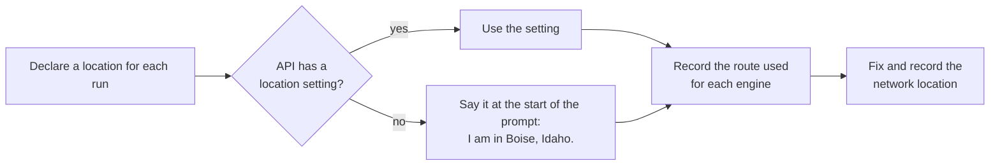

# Engines and location

**RSVP splits every result by engine and by declared location.**

A declared location is a country, or a city for place-dependent questions. Pass it through the engine's location setting where one exists, and state it in the prompt otherwise. Engines treat location differently. In one study ChatGPT followed the declared city and Gemini followed the network's country ([Chen and Koudas, 2026](https://arxiv.org/abs/2610.24081)).

## Which engines should you test?

Test the engines the client's buyers are likely to use. A working range is **three to six**.

**Tidewater Ledger example.** The sample uses three made-up engines, A, B and C, each in search-on mode through an API.

For each engine, record:

- the product
- the mode (search on or off, where the engine allows a choice)
- the model version, where the engine shows it
- the interface (API or web)

Treat two modes of one product as two engines, because their behaviour can differ strongly.

## Why do you not pool engines?

The engine alone changes the rate sharply. In a cohort of 102 brands, Claude named brands on unbranded prompts in 34 to 47% of cases against 9 to 22% for ChatGPT, Perplexity and Gemini, though the Claude sample was small ([Kumar, 2026](https://arxiv.org/abs/2606.20065)).

Three Chinese language models mentioned brands in 88.9% of identical English queries against 58.3% for three international models ([Huang et al., 2025](https://arxiv.org/abs/2601.00869)).

Split every table by engine. Never report a pooled headline.

## What is a declared location?

RSVP does not observe where a user is. You **declare** a location for each run and report what the engine returned for that declaration.

Declare a country for questions that depend on the country, such as tax rules. Declare a city, written as city and country, for questions such as "near me".

## Do engines follow the declared location?

It depends on the engine. [Chen and Koudas (2026](https://arxiv.org/abs/2610.24081)) asked 300 questions with 19 declared locations, and also from five network locations (31,200 answers in all). ChatGPT followed the declared city and ignored the network the call came from, while Gemini ignored the declaration and followed the network's country.

For near-me questions the cited sources of two US cities differed by 0.14 on the study's 0 to 1 localisation index, and cities in two countries differed by 0.28. For questions with no local component the difference was near zero.

*Figure: how a declared location is passed to an engine.*

## How do you pass the location?

Where the API has a location setting, use it. Where it does not, state the location in the prompt text, for example "I am in Boise, Idaho." at the start. [Kumar (2026](https://arxiv.org/abs/2606.20065)) describes the same two routes. Record which route each engine used.

**Tidewater Ledger example.** Engines A and C use the location setting. Engine B gets the sentence I am in United States at the start of the prompt. The network location was a fixed test network, United States (fictional).

Also fix and record the network location of your calls. An engine that follows the network gives different answers from different networks ([Chen and Koudas, 2026](https://arxiv.org/abs/2610.24081)).

## How many locations do you need?

One declared location is enough for a national question list. For local questions one city is not enough.

Near-me recommendations in one US city captured only 8% of the businesses recommended in another of 15 cities, and 96% of near-me businesses appeared in only one of the 15 cities ([Chen and Koudas, 2026](https://arxiv.org/abs/2610.24081)). A city result describes that city only. For a claim about a region, use several cities and report each separately.

## What does the report state?

For each engine, state the product and mode, the interface, the declared location and how you passed it, and the network location.

See also: [Inputs](inputs.md), [Runs and sample size](runs-and-sample-size.md), [Limitations](limitations.md).

Previous: [Prompt list and intent](prompt-list-and-intent.md) | Next: [Runs and sample size](runs-and-sample-size.md)

Last updated: November 26, 2026
