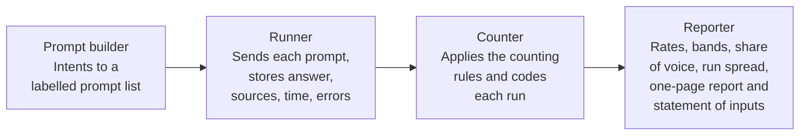
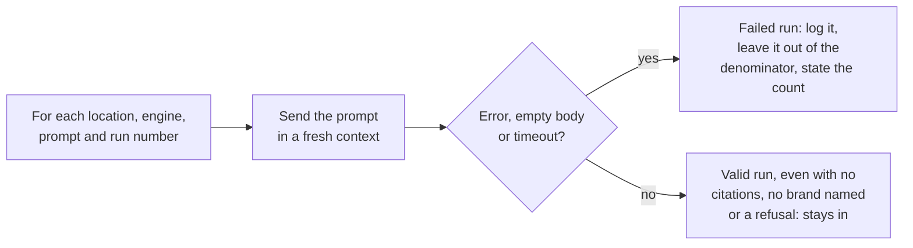

# How does RSVP work?

**RSVP works in four parts that run in order: a prompt builder, a runner, a counter and a reporter.**

The runner calls every combination of declared location, engine, prompt and run number. The counter codes the stored answers, and the reporter turns the codes into rates and bands. The parts are roles, not products, and one person can fill more than one of them.

*Figure: the four parts of RSVP, in the order they run.*

## What does each part do?

- **Prompt builder.** Turns buyer intents into the prompt list, each prompt labelled by intent. Its output is the list and nothing else.
- **Runner.** Sends each prompt to each engine through its API with the declared location. It stores the full answer text and the cited sources with a timestamp, and logs any failure.
- **Counter.** Reads each stored answer and applies the counting rules for mention, citation, position and the other brands named. Its output is one coded row per run.
- **Reporter.** Computes a rate and a band per engine and declared location, plus share of voice and run spread, then writes the one-page report and the statement of inputs.

Keep the parts separate so you can check each alone. Audit the runner by reading stored answers. Audit the counter by re-coding a sample by hand. Audit the reporter by recomputing figures from the run log.

## What is the run loop?

The run loop is the heart of the runner. For each declared location, for each engine, for each prompt, and for each run number up to the planned count, send the prompt in a **fresh context** and record the answer, the cited sources, the time and any error. Space the runs so they do not all land in one short burst.

*Figure: the run loop and what happens to a failed run.*

## How many runs does a measurement make?

The planned number of runs is locations times engines times prompts times runs per prompt. For example, the Tidewater Ledger sample has 10 prompts on 3 engines at 10 runs for one location, which makes 300 planned runs. This is arithmetic, not a recommended size.

## Why does every run use a fresh context?

A follow-up inside an earlier conversation would be shaped by the earlier answer, so the run would no longer be an independent sample of the prompt. This is an RSVP design rule.

## What happens to a failed run?

A run **fails** if the call returns an error, an empty body or a timeout. Log it, leave it out of the denominator, and state in the report how many failed.

In the kit, only these technical failures are retried, up to three attempts per run. A refusal in the answer text is a valid run and is not retried.

Do not call a run failed because the answer has no citations, names no brand or declines to answer. Those are valid outcomes and stay in the denominator. [Martinez (2026a](https://arxiv.org/abs/2607.14035)) warns that discarding responses without search or citations creates selection bias.

## What must the log never do?

Never edit answers after the fact. Never drop inconvenient runs. If the counter finds an error, record the correction as a new row in a change list and keep the original.

See also: [Inputs](inputs.md), [Mention](../framework/1-mention.md), [Citation](../framework/2-citation.md), [Sample report](../reports/sample-report.md).

Previous: [Why do AI answers vary?](why-ai-answers-vary.md) | Next: [How to Run Your First RSVP Measurement: The Quickstart](quickstart.md)

Last updated: November 26, 2026

**Sample files.** The worked example in this doc comes from one dry run for a made-up brand, Tidewater Ledger, in the sample folder of the RSVP kit repository. Raw run log: sample_runlog.jsonl ([view](https://github.com/tanmaypatange/rsvp/blob/main/sample/sample_runlog.jsonl), [raw download](https://raw.githubusercontent.com/tanmaypatange/rsvp/main/sample/sample_runlog.jsonl)). Coded run log: sample_coded_runlog.csv ([view](https://github.com/tanmaypatange/rsvp/blob/main/sample/sample_coded_runlog.csv), [raw download](https://raw.githubusercontent.com/tanmaypatange/rsvp/main/sample/sample_coded_runlog.csv)). Report: sample_report.md ([view](https://github.com/tanmaypatange/rsvp/blob/main/sample/sample_report.md), [raw download](https://raw.githubusercontent.com/tanmaypatange/rsvp/main/sample/sample_report.md)).
