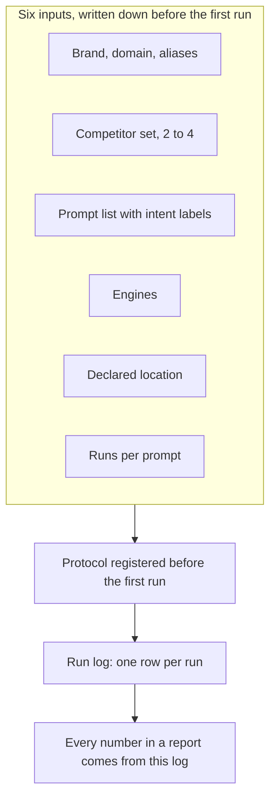

# What does an RSVP measurement need as input?

**An RSVP measurement needs six inputs: a brand, a competitor set, a prompt list, the engines to test, the declared location and the number of runs per prompt.**

Write all six down before the first run. All six appear in the report. The **prompt list** matters most, because it defines the market you measure.

## How do you record the brand?

Record a **name**, a **registrable domain** and an **alias list**. RSVP works at brand and domain level, not exact URL.

Close the alias list before the first run. Adding an alias afterwards changes what counts as a mention.

Changing any input after the first run starts a new measurement ID in the kit. Runs of two measurement IDs are never mixed.

**Tidewater Ledger example.** Tidewater Ledger has the aliases Tidewater and TidewaterLedger, closed before run 1, and excludes Tidewater Capital.

## What is the competitor set?

Name **two to four competitors**, choose them with the client and keep them fixed. The set gives share of voice a stated denominator. See [Prompt list and intent](prompt-list-and-intent.md).

**Tidewater Ledger example.** Quillmark Books, Harrow Accounts and Saltbox Books.

## What is the prompt list?

The prompt list is the set of **buyer questions**, each with one intent label. Two lists for the same brand measure two different markets, so report the list with every result. See [Prompt list and intent](prompt-list-and-intent.md).

**Tidewater Ledger example.** 10 prompts, P01 to P10: 3 informational, 3 commercial and 3 transactional unbranded prompts, and P10, a branded prompt kept in its own block.

## Which engines and which location?

Engines are the AI products you test. Record the mode, interface and version of each. The **declared location** is a country or a city you state for each run. See [Engines and location](engines-and-location.md).

**Tidewater Ledger example.** Three made-up engines, A, B and C, all in search-on mode through an API.

## How many runs per prompt?

Runs per prompt is your **sample size**. Pick it from the band width the decision needs. See [Runs and sample size](runs-and-sample-size.md).

**Tidewater Ledger example.** 10 runs per prompt, which makes the measurement a pilot.

*Figure: the six inputs, the protocol and the run log.*

## Why do you fix the inputs first?

If you could change the prompt list, the competitor set or the alias list after seeing answers, the result would describe your choices more than the engines.

[Martinez (2026b](https://arxiv.org/abs/2609.06811)) makes the underlying point: the prompt corpus defines the answer market, so the corpus is part of the result. RSVP therefore treats the inputs as a **protocol registered before the first run**. This is an RSVP decision.

## What do you keep for every run?

Keep one row per run in a **run log**:

- date, engine, prompt, intent and declared location
- whether the run was valid
- the full answer text
- the brands named, in order
- the mention and citation flags, the position and the domains cited

[Martinez (2026a](https://arxiv.org/abs/2607.14035)) recommends keeping prompts, raw responses, citations, search status, timestamps and locale for reproducibility. Every number in a report comes from this log.

See also: [How RSVP works](how-rsvp-works.md), [Prompt list and intent](prompt-list-and-intent.md), [Engines and location](engines-and-location.md), [Runs and sample size](runs-and-sample-size.md).

Previous: [Install and run the kit](install-and-run-the-kit.md) | Next: [Prompt list and intent](prompt-list-and-intent.md)

Last updated: November 26, 2026
