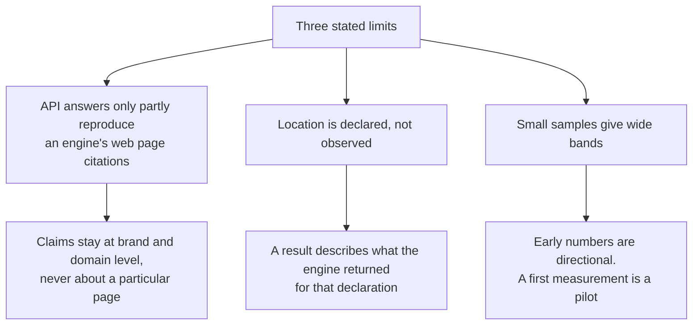

# What are the limitations of RSVP?

**RSVP has three stated limits.**

API answers only partly reproduce what an engine's web page cites, location is declared and not observed, and small samples give wide bands. RSVP does not explain why a brand is or is not named, and it makes no claim about traffic or sales. Every report states these limits.

## Why are claims kept at domain and brand level?

API answers only partly reproduce what an engine's web page cites at exact-URL level. [Jiang et al. (2026](https://arxiv.org/abs/2610.15382)) found that alternatives to ChatGPT Web matched it better at hostname and entity level than at exact URL. RSVP therefore reports mentions and citations by brand and domain.

## Is location observed?

No. Location is declared for each run, and a result describes what the engine returned for that declaration. Some engines follow the declared location and others follow the network ([Chen and Koudas, 2026](https://arxiv.org/abs/2610.24081)).

## How reliable is a small sample?

Small samples give wide bands, so early numbers are directional. A first measurement is a pilot, and the report says so.

*Figure: the three stated limits and what the report does about each.*

## What further threats should a reader know?

| **Threat** | **What it does** | **What RSVP does about it** |
|---|---|---|
| Prompt choice | The list defines the market | Report the list, report by intent |
| Pseudoreplication | Near-copies of a prompt look like independent evidence | One label per need, report at need level |
| Run dependence | Runs share the prompt list and brand, so bands are slightly narrow | State the assumption, show prompt-level counts |
| Detection error | Name matching can miss or over-count | Alias list, sample check, second coder |
| Engine change | Models and indexes change without notice | Date every run, re-measure every few weeks |
| Mode differences | Search on or off changes behaviour | Record the mode, treat modes as separate engines |
| Personalisation | Account history can shape answers | Fresh context per run, no logged-in history |
| No-search runs | Some runs return no citations at all | Keep them as valid outcomes and report their count |
| Silent model change | A session can fall back to another model | Record the serving model per response where shown |
| Synthetic prompt corpora | Simulated buyers may not behave like real ones | Do not weight by assumed shares |

Two ChatGPT sessions in one study fell back to another model after 14 and 16 runs ([Jiang et al., 2026](https://arxiv.org/abs/2610.15382)). In the study by [Schulte et al. (2026](https://arxiv.org/abs/2604.07585)), 57.8% of ChatGPT repetitions did not activate web search.

## What can RSVP not tell you?

- Why. RSVP does not explain why a brand is or is not named. Suspected causes are marked as hypotheses.
- Whether an action works. Published evidence on intervention is narrow ([Martinez, 2026a](https://arxiv.org/abs/2607.14035)).
- What any person sees. RSVP samples the engine under stated conditions.
- Business impact. Clicks, visits and sales are outside the method.
- Whether a mention is paid. The kit leaves out blocks an adapter marks as sponsored, but the bundled adapters mark none, so a paid block inside the answer text counts as an ordinary mention.
- Sentiment or accuracy. Version 0.1 measures presence and order, and does not judge tone or check claims.

## Where is RSVP today and what is next?

RSVP is at an early stage. The method is documented, and no measurement of a real brand has been published under v0.1. The next step is a small automated workflow that builds the prompt list from buyer intents, loops over every combination of prompt, engine and run number through each engine's API, counts mentions and citations, and writes the one-page report.

Planned improvements, in order: a prompt-clustered bootstrap band, a band for share of voice, a tone and accuracy measure validated on a human-coded sample, and more declared locations for local prompts. None has a date.

Previous: Reading results | Next: RSVP FAQ

Last updated: November 26, 2026
