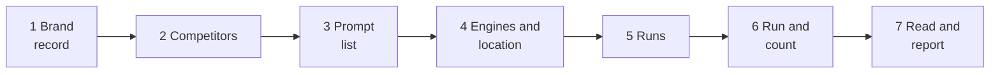

# How to Run Your First RSVP Measurement: The Quickstart

**To run a first RSVP measurement, write down six inputs before the first run: the brand and aliases, two to four competitors, a labelled prompt list, the engines, the declared location and the runs per prompt.**

Then run every combination, log every answer, count mentions and citations, and compute a rate with a 95% Wilson band for each engine.

Seven steps take you from the inputs to a report. Do them in this order.

| **Step** | **What you decide** | **What you have afterwards** |
|---|---|---|
| 1. Brand record | Name, domain and aliases | A closed alias list |
| 2. Competitors | Two to four named rivals | A fixed competitor set |
| 3. Prompt list | Buyer questions, each labelled | A labelled prompt list |
| 4. Engines and location | Engines and a declared country or city | A run plan |
| 5. Runs | Runs per prompt, pilot first | A stated run count |
| 6. Run and count | A fresh context for every run | A run log and rates with bands |
| 7. Read and report | A fixed reading order | The one-page report |

*Figure: the seven quickstart steps and what each leaves you with.*

## Step 1: Record the Brand

Write the brand name, its registrable domain and a fixed list of aliases, such as short forms and spelling variants. Close the alias list before the first run. Adding an alias afterwards changes what counts as a mention, so it needs a new version of the measurement.

**Tidewater Ledger example.** Brand Tidewater Ledger, domain tidewaterledger.example, aliases Tidewater and TidewaterLedger, exclusion Tidewater Capital (a different company).

## Step 2: Name the Competitors

Name two to four competitors with the client before the first run. Pick rivals the client would name and brands that buyers' questions would plausibly produce. The set stays fixed. Other brands the engines name are logged and listed as "other brands named", and they are not counted in share of voice.

**Tidewater Ledger example.** Quillmark Books, Harrow Accounts and Saltbox Books, named before the first run and fixed.

## Step 3: Write the Prompt List

Write the questions a buyer would ask an AI assistant about the category. Keep the headline list unbranded, so no prompt names the client. Give each prompt one label: informational, commercial or transactional. Four to eight prompts per intent is a working range for a first measurement.

**Tidewater Ledger example.** 10 prompts: 9 unbranded (3 informational, 3 commercial, 3 transactional) and 1 branded, P10, reported apart. P01 reads: How should a two-person design studio keep its books without hiring an accountant?

## Step 4: Choose Engines and a Location

Choose the engines buyers are likely to use, usually three to six, and record the product, mode, interface and version of each. Declare a country, or a city for place-dependent questions, and record how it was passed to each engine. Fix the network location the calls come from.

**Tidewater Ledger example.** Three made-up engines, A, B and C, with the declared location United States. Engines A and C take the location through a setting. Engine B gets the sentence I am in United States at the start of the prompt.

## Step 5: Choose the Number of Runs

Choose runs per prompt from the band width the decision needs. Start with a pilot of 5 to 10 runs per prompt on one engine and read the band. Add runs where the result is close to a decision. Spread the runs across several days. State the count and say if the sample is a pilot.

**Tidewater Ledger example.** 10 runs per prompt over 5 days: 300 planned runs, a pilot.

## Step 6: Run and Count

For every combination of declared location, engine, prompt and run number, send the prompt in a fresh context. Store the full answer, the cited sources, the time and any error. Exclude only technical failures. Then code mention, citation, position and the other brands named, and compute each rate with a 95% Wilson band.

**Tidewater Ledger example.** The run log has 300 rows. R00001 is Engine A, prompt P01, on 2026-11-02. 296 runs were valid and 4 failed (2 errors, 1 timeout, 1 empty body). 2 refusals stayed in as valid runs.

## Step 7: Read and Report It

Read the result in a fixed order: inputs, band, engine, intent, citation, position, share of voice and spread. Report the one-page format from the Sample report page with the six reporting rules. Plan the next measurement for four weeks later, with the same inputs.

**Tidewater Ledger example.** Engine C is above Engine A and Engine B on visibility, 71% against 28% and 27%, and the bands do not overlap. Engine A and Engine B overlap, so no difference is shown. The whole report is in the sample files.

Read the [Inputs](inputs.md) page for each input in detail, then the [Reporting Rules v0.1](../specifications/reporting-rules-v01.md) page.

Previous: [How does RSVP work?](how-rsvp-works.md) | Next: [Install and run the kit](install-and-run-the-kit.md)

Last updated: November 26, 2026

**Sample files.** The worked example in this doc comes from one dry run for a made-up brand, Tidewater Ledger, in the sample folder of the RSVP kit repository. Raw run log: sample_runlog.jsonl ([view](https://github.com/tanmaypatange/rsvp/blob/main/sample/sample_runlog.jsonl), [raw download](https://raw.githubusercontent.com/tanmaypatange/rsvp/main/sample/sample_runlog.jsonl)). Coded run log: sample_coded_runlog.csv ([view](https://github.com/tanmaypatange/rsvp/blob/main/sample/sample_coded_runlog.csv), [raw download](https://raw.githubusercontent.com/tanmaypatange/rsvp/main/sample/sample_coded_runlog.csv)). Report: sample_report.md ([view](https://github.com/tanmaypatange/rsvp/blob/main/sample/sample_report.md), [raw download](https://raw.githubusercontent.com/tanmaypatange/rsvp/main/sample/sample_report.md)).
