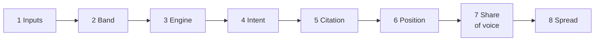

# Reading results

**Read an RSVP result in order: inputs, band, engine, intent, citation, position, share of voice and spread.**

A low rate is not automatically a problem. Check the band and the prompt list first, then the pattern across measures, then compare with competitors, and treat any cause as a hypothesis to re-measure.

## In what order do you read a result?

1. **Inputs:** the prompt list, engines, declared location, run count and dates. A result without them has no meaning.
2. **Band, not rate.** A rate of 30% with a band of 25 to 35 is a firm statement. With a band of 15 to 50 it is a hint.
3. **Engine.** Never average across engines.
4. **Intent.** A low overall rate may come entirely from informational prompts that never call for a product.
5. **Citation and ghost citations.** Check whether the brand's pages are used, and credited.
6. **Position when mentioned.** Check whether the brand is early or late.
7. **Share of voice and competitors.**
8. **Spread** between runs and across days.

*Figure: the fixed reading order.*

## Is a low rate a problem?

Not automatically. Three things can make a low rate correct.

- The prompts may not call for the brand, as with informational questions about accounting methods for a product brand.
- The brand may not be a reasonable answer, for example a prompt about ten-person firms when the brand serves freelancers.
- The band may be wide.

[Kumar (2026](https://arxiv.org/abs/2606.20065)) offers a picture. In that cohort, 63.2% of tracked brand, prompt and engine cells on unbranded prompts were never mentioned, 14.3% were always mentioned and only 6.8% flipped between 30% and 70%. Brand stature was the largest determinant of visibility on day one, about 30 points per tier. The data are observational, so they describe a pattern and prove no cause.

## What do you do with a low rate?

1. **Check the band.** If it is wide, run more first.
2. **Check the prompt list.** Ask whether it is a fair statement of the market. A low rate on a list the client would not recognise is a finding about the list ([Martinez, 2026b](https://arxiv.org/abs/2609.06811)).
3. **Look at the pattern,** using the table below.
4. **Compare with competitors.** [Monaco et al. (2026](https://arxiv.org/abs/2611.07614)), auditing 1,176 brands, found top-quintile brands cited 1.4 to 2.8 times more than average. A low rate against much better known competitors differs from one against equals.
5. **Write each suspected cause as a hypothesis,** make a change, and run the same inputs again after a few weeks.

| **Pattern** | **What it points to** |
|---|---|
| Low mention, low citation | The brand and its pages are not reaching these answers |
| Low mention, citations present | The engine uses the brand's pages but does not name the brand |
| Mentioned, but always late | The brand is known but not preferred |
| High on commercial, low on informational | Normal for a product brand. Check if informational prompts were meant to be won |
| High on one engine, low on another | An engine-specific issue, such as different sources or a mode without search |
| Wide spread between runs | The brand sits at the edge of the answer |

## What about eligible and ineligible prompts?

Optionally, code each prompt as **eligible** (the brand genuinely matches what the prompt asks) or **ineligible** before the first run, and report the two groups separately.

An eligible prompt with a low rate is an unexplained absence worth a closer look. Eligibility does not create entitlement. An ineligible prompt with a high rate is good news and not a target.

## What wording should a report use?

| **Say** | **Do not say** |
|---|---|
| Mentioned in 20 of 89 valid runs (22%, band 15 to 32) | The brand appears 22% of the time |
| Not observed in 29 runs | Never appears |
| Higher on Engine C than on Engine B for this prompt list | Engine C likes us more |
| The measurement shows X. A possible reason is Y, to be tested | X happened because of Y |
| Share of voice against the three named competitors | Market share |

## Does a move in a rate prove an action worked?

No. A move beyond the old band is a change in the measured outcome, not proof that an action caused it, because engines also change on their own. A critical survey of 45 studies found no reviewed technique with a stable, longitudinal, cross-platform causal effect on organic discoverability ([Martinez, 2026a](https://arxiv.org/abs/2607.14035)). RSVP promises no outcome from any action.

See also: [Confidence bands](../framework/5-confidence-bands.md), [Run spread](../framework/7-run-spread.md), [Share of voice](../framework/6-share-of-voice.md), [Limitations](limitations.md).

Previous: [Runs and sample size](runs-and-sample-size.md) | Next: What are the limitations of RSVP?

Last updated: November 26, 2026

**Sample files.** The worked example in this doc comes from one dry run for a made-up brand, Tidewater Ledger, in the sample folder of the RSVP kit repository. Raw run log: sample_runlog.jsonl ([view](https://github.com/tanmaypatange/rsvp/blob/main/sample/sample_runlog.jsonl), [raw download](https://raw.githubusercontent.com/tanmaypatange/rsvp/main/sample/sample_runlog.jsonl)). Coded run log: sample_coded_runlog.csv ([view](https://github.com/tanmaypatange/rsvp/blob/main/sample/sample_coded_runlog.csv), [raw download](https://raw.githubusercontent.com/tanmaypatange/rsvp/main/sample/sample_coded_runlog.csv)). Report: sample_report.md ([view](https://github.com/tanmaypatange/rsvp/blob/main/sample/sample_report.md), [raw download](https://raw.githubusercontent.com/tanmaypatange/rsvp/main/sample/sample_report.md)).
