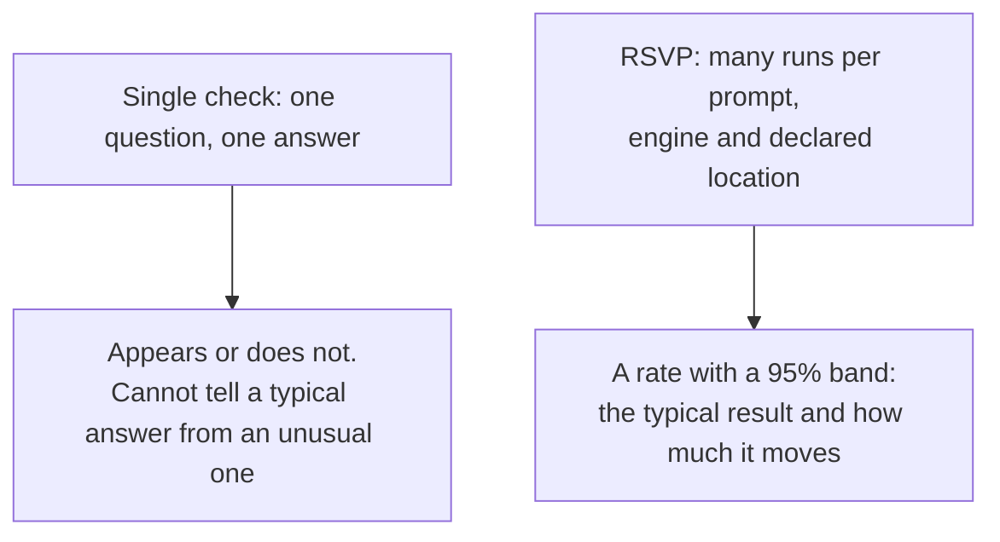
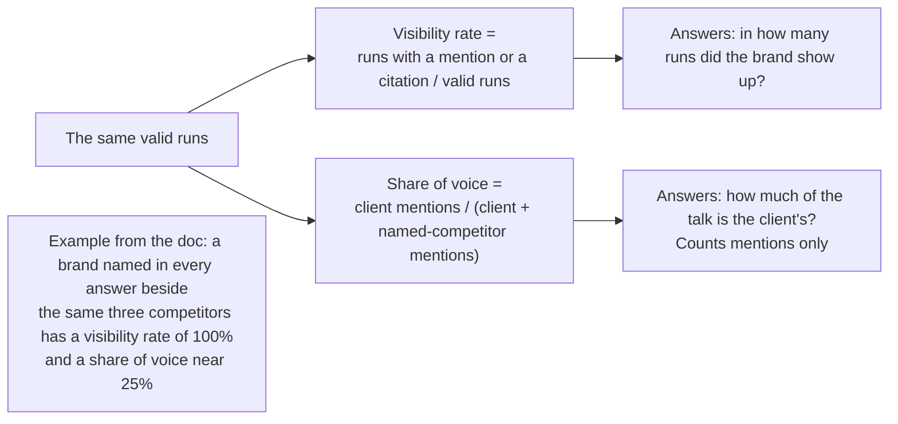

# RSVP vs single checks and share of voice

**A single check shows one answer from a noisy process. RSVP asks the same question many times and reports a rate with a 95% band.**

The rate shows both the typical result and how much it moves. Share of voice is a different figure: the client's share of brand mentions against named competitors. RSVP reports both and keeps them apart.

## What is the difference between RSVP and a single check?

A single check asks one question once. The answer could be typical or unusual, and the check cannot tell which.

RSVP asks each question many times on each engine and declared location. It then reports the mention, citation and visibility rates with a band, so you can see how sure the result is.

*Figure: a single check against RSVP.*

## What is the difference between RSVP and share of voice?

Share of voice divides the client's mentions by the client's plus the named competitors' mentions over the same runs. It answers how much of the talk is the client's. The visibility rate answers in how many runs the brand showed up.

A brand named in every answer, always beside the same three competitors, has a visibility rate of 100% and a share of voice near 25%.

**Tidewater Ledger example.** On Engine C the sample shows visibility of 71% (63 of 89 valid runs) and a share of voice of 32.1% (52 of 162 brand mentions). They answer different questions: in how many runs the brand showed up, and how much of the naming was the client's.

*Figure: the same runs give two different figures.*

## Why does the prompt list matter for share of voice?

The prompt list defines the market you measure. [Martinez (2026b](https://arxiv.org/abs/2609.06811)) states that a figure such as "cited in 40% of answers" is not interpretable without the engine, the period and the weights.

[Kumar (2026](https://arxiv.org/abs/2606.20065)) found average visibility of 22.9% on broad discovery prompts and 74.6% on comparison prompts. The same brand gives very different figures on different lists.

## Which should you use?

- **Single check:** to read one answer in detail, for example how an engine words a recommendation.
- **Share of voice:** as a summary only when the prompt list, engines, declared location, run count and denominator are stated next to it.
- **RSVP:** when the question is whether the brand comes up, where, and how sure the measurement is.

## Do RSVP and a single check conflict?

No. A single check is one sample, and RSVP is many samples of the same kind. Reading one answer closely is useful. Treating it as the rate is the mistake RSVP is built to avoid.

Read the [Share of voice](../framework/6-share-of-voice.md) page for the formula, then the [Quickstart](quickstart.md).

Previous: [What is RSVP?](what-is-rsvp.md) | Next: [Why do AI answers vary?](why-ai-answers-vary.md)

Last updated: November 26, 2026
