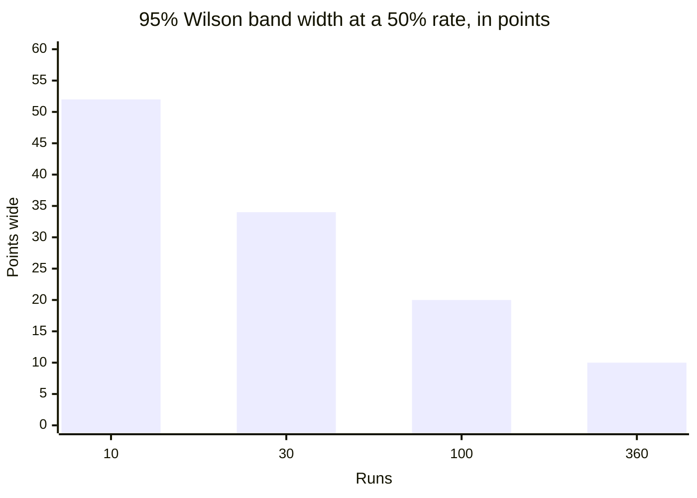
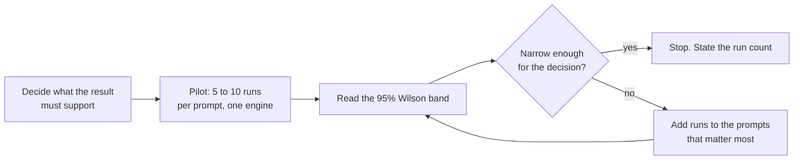

# Runs and sample size

**Runs per prompt is the sample size, and RSVP does not set a minimum.**

The three engines at 10 runs per prompt in the Tidewater Ledger sample report are a pilot and an example of the format, not a standard. You choose the run count from the band width the decision needs. A pilot of 5 to 10 runs per prompt shows what the band looks like before you add more runs.

## What does the research say about run counts?

No public paper sets a required number of runs for a brand visibility measurement.

[Schulte et al. (2026](https://arxiv.org/abs/2604.07585)) ran up to ten repetitions per prompt per engine and suggest seven to eight as a starting point. In their data, the standard error of a per-brand detection rate fell below 0.10 at seven same-day runs and below 0.08 at eight. A rolling window needed 10 days for under 0.10 and 24 days for under 0.05. This was one study of four Swiss verticals with a name-matching lexicon.

[Martinez (2026a](https://arxiv.org/abs/2607.14035)) notes that the seven to eight figure comes from a small universe of queries and recommends **sequential precision**: repeat until the interval is narrow enough for the decision, starting from a pilot.

## What does a run count buy?

The width of a 95% Wilson band depends on the number of runs. The table shows bands in percentage points for observed rates, with the count rounded from rate times runs. The values are computed, and the rates are illustrative.

| **Runs** | **Rate 10%** | **Rate 30%** | **Rate 50%** | **Rate 70%** |
|---|---|---|---|---|
| 10 | 2 to 40 | 11 to 60 | 24 to 76 | 40 to 89 |
| 30 | 3 to 26 | 17 to 48 | 33 to 67 | 52 to 83 |
| 100 | 6 to 17 | 22 to 40 | 40 to 60 | 60 to 78 |
| 360 | 7 to 14 | 25 to 35 | 45 to 55 | 65 to 75 |

At ten runs a rate of 4 in 10 is consistent with a true rate from 17 to 69 percent. That is too wide to tell a strong result from a weak one.

In the Tidewater Ledger sample, Engine A's visibility rate is 28% (25 of 89 valid runs) with a band of 20 to 38. The same engine's mention rate on a single day, from 17 or 18 valid runs, has bands between 30 and 40 points wide. More runs per cell narrow the band.

*Figure: band width at a 50% rate falls as runs grow (values from the table above).*

## How do you choose a run count?

1. Decide the decision. "Is the brand mentioned at all?" needs fewer runs than "Did the rate change by ten points?"
2. Run a pilot of 5 to 10 runs per prompt on one engine.
3. Read the band. If it is narrow enough for the decision, stop. If not, add runs to the prompts that matter most.
4. State the count per prompt and per engine in the report.

RSVP gives no fixed tier by purpose. Guides disagree on the numbers, and Schulte et al. (2026) points to seven to eight same-day runs, so let band width decide.

*Figure: choosing a run count by band width.*

## Why do you spread the runs over days?

Answers drift. [Schulte et al. (2026](https://arxiv.org/abs/2604.07585)) found different overlap within 24 hours and across days. Clustering all runs into one afternoon hides day-to-day drift and makes the band look better than the measurement deserves. Spread runs across several days and times.

## What does it cost?

Each run is an API call. Cost grows with prompts times engines times runs times locations. Treat a first measurement as a pilot, and say so in the report.

See also: [Confidence bands](../framework/5-confidence-bands.md), [Run spread](../framework/7-run-spread.md), [Reporting Rules v0.1](../specifications/reporting-rules-v01.md).

Previous: [Engines and location](engines-and-location.md) | Next: [Reading results](reading-results.md)

Last updated: November 26, 2026
