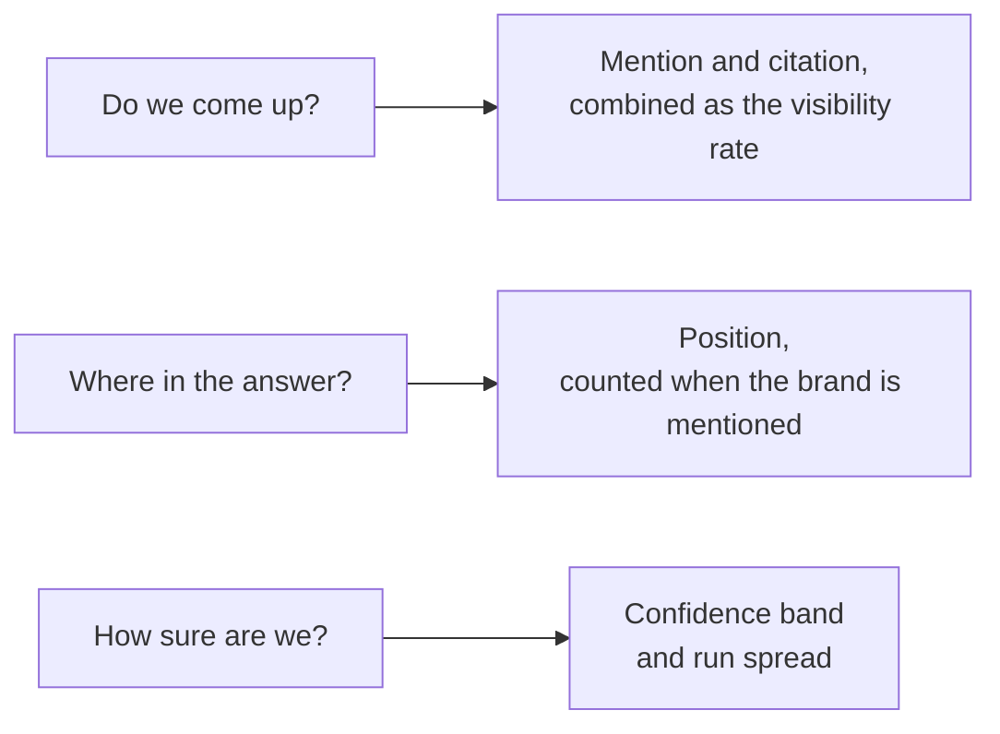

# What is RSVP?

**Repeated Sampling of Visibility and Position (RSVP) measures how visible a brand is in AI answers.**

RSVP runs each buyer question many times on each AI engine and reports the share of runs in which the brand is mentioned or cited, with a confidence band. The shortest possible definition: **RSVP is a rate with a band, not a single check.**

## What question does RSVP answer?

A client who asks for an AI visibility measurement is asking one question in three parts. When buyers ask an AI assistant about our category, do we come up, where in the answer do we come up, and how sure are we? RSVP answers each part with a separate measure, so no single number has to carry all three.

- **Do we come up?** Mention and citation, combined as the visibility rate.
- **Where?** Position, counted when the brand is mentioned.
- **How sure?** The confidence band and the run spread.

*Figure: the three parts of the client's question and the measure that answers each.*

## What does the name mean?

RSVP stands for **Repeated Sampling of Visibility and Position**. The first two words name the method: every answer is one sample, and you repeat the sampling. The last two name what you measure: whether the brand is visible in the answer, and where it sits.

## What does an RSVP measurement produce?

One measurement produces a **one-page report**. The report shows the visibility range per engine and declared location, the position of the brand when it is named, its share of voice against named competitors and the run spread.

It states the prompt list, the engines, the run count and the date, so a reader can see exactly what you measured.

**Tidewater Ledger example.** One measurement of Tidewater Ledger (made up) is 300 planned runs: 10 prompts, 3 engines and 10 runs per prompt, over 5 days. 296 runs were valid and 4 failed. The one-page report is the sample report in the kit repository.

## What does RSVP not do?

- It does not say why a brand is or is not named.
- It does not promise that any action will raise a rate.
- It does not predict traffic, clicks or revenue.
- It does not produce a composite "AI visibility score".
- It does not measure what one person sees on their own device.

The Limitations page lists each boundary.

## Where does RSVP sit in AI visibility work?

AI visibility work has at least three parts: measuring what engines say now, diagnosing why, and improving. RSVP covers only **measuring**.

A critical survey of 45 studies found that no reviewed technique showed a stable, longitudinal, cross-platform causal effect on organic discoverability ([Martinez, 2026a](https://arxiv.org/abs/2607.14035)). A reliable measurement is therefore the base for testing any improvement.

Read [Why do AI answers vary?](why-ai-answers-vary.md) for the evidence behind repeated sampling, then the [Quickstart](quickstart.md) to run a first measurement.

Previous: [RSVP](../README.md) | Next: [RSVP vs single checks and share of voice](rsvp-vs-single-checks.md)

Last updated: November 26, 2026
