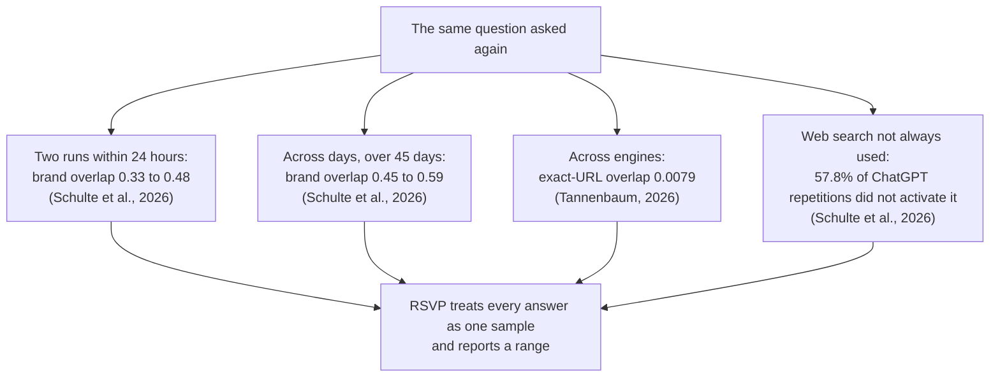

# Why do AI answers vary?

**The same question asked twice to an AI engine can produce different brands and different sources.**

In one study of four engines and three verticals, the brands named in two runs within 24 hours overlapped by 0.33 to 0.48 on average, depending on the vertical, on a scale where 1.0 means identical ([Schulte et al., 2026](https://arxiv.org/abs/2604.07585)). RSVP is built around this variation, so it treats every answer as one sample and reports the range.

## How much do answers differ between runs?

[Schulte et al. (2026](https://arxiv.org/abs/2604.07585)) ran up to ten repetitions of each prompt within 24 hours on ChatGPT, Gemini, Google AI Mode and Perplexity, using eight prompts in each of four Swiss verticals.

The overlap between the brands named in two runs was 0.33 to 0.48, and the overlap between the sources cited was 0.32 to 0.43. The overlap is the **Jaccard index**: shared members divided by all members.

## Do answers change from day to day?

Yes. In the same study, brand overlap across days was 0.45 to 0.59 and source overlap from one day to the next was 0.34 to 0.42, over 45 days ([Schulte et al., 2026](https://arxiv.org/abs/2604.07585)).

[Tannenbaum (2026](https://arxiv.org/abs/2609.22655)) reports adjacent-day source turnover of 67.0% (95% interval 61.1 to 72.2) on a benchmark of 15 commercial prompts. That interval describes the benchmark only.

## Do engines differ from each other?

Yes. [Tannenbaum (2026](https://arxiv.org/abs/2609.22655)) reports a cross-engine exact-URL overlap of 0.0079 on the same benchmark. [Chen et al. (2025](https://arxiv.org/abs/2509.08919)) found that AI search favours earned media over brand-owned and social content, and that engines differ in domain diversity, freshness and sensitivity to phrasing. For this reason, never report one pooled figure across engines.

## Does a fixed temperature fix the answer?

No. A critical survey of 45 studies notes that a reported temperature of zero fixes neither the search index, nor retrieval, nor the versions of outside services ([Martinez, 2026a](https://arxiv.org/abs/2607.14035)). It cites an audit in which repeated runs at temperature zero still changed 9 to 28% of decisions on the surfaces where temperature could be set.

## Do engines always search the web?

No. In the setup studied by [Schulte et al. (2026](https://arxiv.org/abs/2604.07585)), 57.8% of ChatGPT repetitions did not activate web search. A run with no search and no citations is a valid outcome. Keep it in the denominator of every rate ([Martinez, 2026a](https://arxiv.org/abs/2607.14035)).

*Figure: where answers vary, with the figures from the cited studies.*

## What does this mean for a single check?

A single check records one draw. If the brand appears, the check cannot say whether it appears most of the time or once in a while. If the brand is missing, it cannot say whether the brand is rare or the draw was unlucky.

**Tidewater Ledger example.** In the sample, Engine A's mention rate was 18% on the first day and 33% on the last (3 of 17 and 6 of 18 valid runs). The bands, 6 to 41 and 16 to 56, overlap, so the move is noise and not a finding.

## What does repeated sampling change?

Repeated sampling asks the question many times. The share of runs that name the brand is a **rate**, and the band around it shows how sure the measurement is.

None of these studies measures a given brand's true visibility, so the figures above describe the studies and not any one client.

Read [RSVP vs single checks and share of voice](rsvp-vs-single-checks.md), then the [Runs and sample size](runs-and-sample-size.md) page.

Previous: [RSVP vs single checks and share of voice](rsvp-vs-single-checks.md) | Next: [How does RSVP work?](how-rsvp-works.md)

Last updated: November 26, 2026
