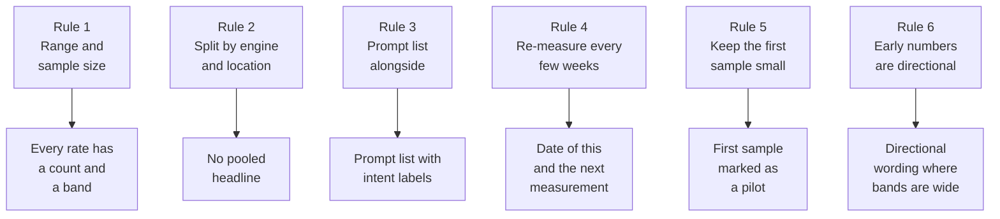

# RSVP Reporting Rules v0.1: Draft Specification

**Status: draft.**

These are the first published reporting rules. They may change in later versions, and the changelog records each change. The rules set what every RSVP report must show so that a reader cannot mistake one sample for a fact. They apply to every measurement, whatever the brand or category.

## What are the design principles?

- **Samples, not facts.** Each answer is one sample from a noisy process, so results are ranges.
- **Declared, not observed.** Location is declared for each run and results are reported as such.
- **Domain and brand level.** API answers only partly reproduce what an engine's web page cites at exact-URL level, so claims stay at domain and brand level ([Jiang et al., 2026](https://arxiv.org/abs/2610.15382)).
- **Stated market.** The prompt list defines the market being measured, so it is reported with the results.

## What are the rules?

1. Report the range and the sample size, never a single number.
2. Split every result by engine and by declared location.
3. Report the prompt list alongside the results. Do not call a score share of voice without stating the prompt list behind it.
4. Re-measure every few weeks. Engines change, and a measurement from last quarter is not a measurement of today.
5. Keep the first sample small and say so. API costs grow with the number of runs.
6. Treat early numbers as directional, because small samples give wide bands.

## Why does each rule exist?

1. One sample from a noisy process is not a fact ([Schulte et al., 2026](https://arxiv.org/abs/2604.07585); [Martinez, 2026a](https://arxiv.org/abs/2607.14035), [2026b](https://arxiv.org/abs/2609.06811)).
2. Engines differ in what they say and in how they use location, and pooling produces an average that describes no real engine ([Chen and Koudas, 2026](https://arxiv.org/abs/2610.24081); [Kumar, 2026](https://arxiv.org/abs/2606.20065); [Tannenbaum, 2026](https://arxiv.org/abs/2609.22655)).
3. The prompt list is the market, and a share of voice with no prompt list cannot be checked ([Martinez, 2026b](https://arxiv.org/abs/2609.06811)).
4. Answers drift. [Schulte et al. (2026](https://arxiv.org/abs/2604.07585)) saw brand overlap across days of 0.45 to 0.59 over 45 days, and [Kumar (2026](https://arxiv.org/abs/2606.20065)) concludes a quarterly cadence is too slow. The default of four weeks is an RSVP choice, since no paper sets it.
5. A first measurement is a pilot. This is an RSVP decision.
6. A small sample has a wide band, so early numbers are read as direction only.

## Why six rules, when the overview lists four?

The overview lists four: the range and sample size, the share of voice caveat, re-measuring every few weeks, and keeping the first sample small. Rule 2 and rule 6 state ideas that the overview gives elsewhere, in its description of what RSVP measures and its current limitations. This specification numbers them so a report can be checked against a list. The four are a subset of the six, so the two documents do not conflict.

*Figure: the six reporting rules and what a report must show for each.*

## How is a report checked?

| **Check** | **Rule** |
|---|---|
| Every rate has a count and a band | 1 |
| No pooled headline across engines or locations | 2 |
| Prompt list attached, with intent labels | 3 |
| Share of voice states prompts, engines, location, runs and denominator | 3 |
| Date of the measurement and of the next | 4 |
| First sample marked as a pilot where it is one | 5 |
| Directional wording used where bands are wide | 6 |
| Limits section present | All |

## How does the kit apply rules 5 and 6?

The kit labels a report a pilot when the runs per prompt are at or below the pilot threshold, which defaults to 10, or when the config says it is a first measurement. It marks the headline directional when any headline band is wider than the directional band width, which defaults to 20 points, or when the sample is a pilot. Both numbers are RSVP decisions and are set in the config.

Previous: [7. Run Spread](../framework/7-run-spread.md) | Next: [Sample report](../reports/sample-report.md)

Last updated: November 26, 2026

**Sample files.** The worked example in this doc comes from one dry run for a made-up brand, Tidewater Ledger, in the sample folder of the RSVP kit repository. Raw run log: sample_runlog.jsonl ([view](https://github.com/tanmaypatange/rsvp/blob/main/sample/sample_runlog.jsonl), [raw download](https://raw.githubusercontent.com/tanmaypatange/rsvp/main/sample/sample_runlog.jsonl)). Coded run log: sample_coded_runlog.csv ([view](https://github.com/tanmaypatange/rsvp/blob/main/sample/sample_coded_runlog.csv), [raw download](https://raw.githubusercontent.com/tanmaypatange/rsvp/main/sample/sample_coded_runlog.csv)). Report: sample_report.md ([view](https://github.com/tanmaypatange/rsvp/blob/main/sample/sample_report.md), [raw download](https://raw.githubusercontent.com/tanmaypatange/rsvp/main/sample/sample_report.md)).
